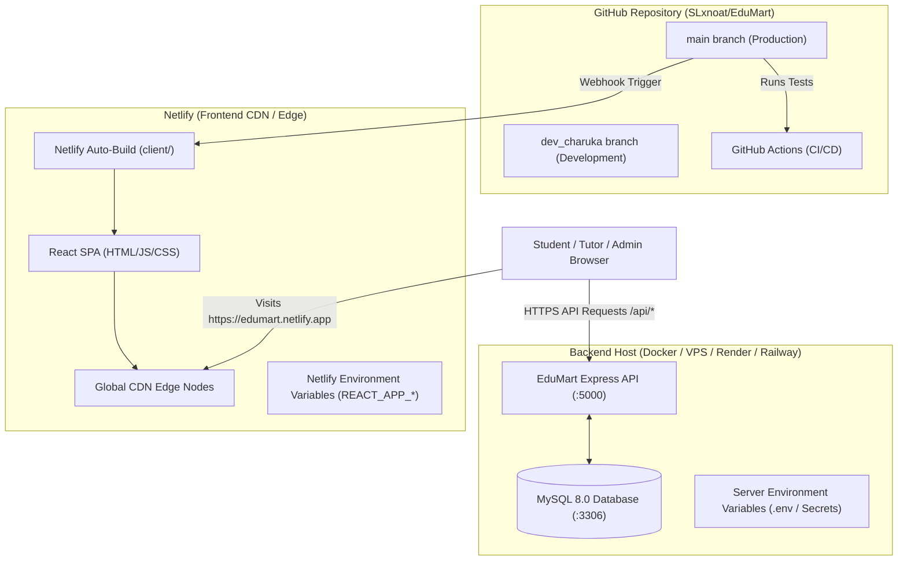

# EduMart Deployment Guide: GitHub + Netlify + Backend

This comprehensive guide walks you through deploying the **EduMart** platform to production using **GitHub** for version control and continuous integration, **Netlify** for high-performance React frontend hosting, and your chosen cloud environment for the **Node.js/Express API & MySQL database**.

---

## Architecture Overview



---

## Part 1: GitHub Repository & Secrets Setup

### 1.1 Branches Strategy
- **`main`**: Production-ready code. Commits pushed here trigger automatic production deployments on Netlify and backend CI pipelines.
- **`dev_charuka`** (or feature branches): Active development branch. Use Pull Requests to merge tested code into `main`.

### 1.2 Configuring GitHub Secrets
If you use GitHub Actions (defined in `.github/workflows/ci-cd.yml`) to test code and push Docker images to Docker Hub:

1. Navigate to your repository on GitHub: `https://github.com/SLxnoat/EduMart`.
2. Click **Settings** $\rightarrow$ **Secrets and variables** $\rightarrow$ **Actions**.
3. Under **Repository secrets**, click **New repository secret**.
4. Add the following secrets if automated Docker image builds are desired:
   - `DOCKER_USERNAME`: Your Docker Hub username.
   - `DOCKER_PASSWORD`: Your Docker Hub personal access token (recommended) or password.

---

## Part 2: Netlify Deployment Walkthrough (Frontend)

EduMart includes a pre-configured [`netlify.toml`](file:///run/media/charuka/f88b2156-0321-44f6-acba-12660ce484181/web/EduMart/netlify.toml) and [`client/public/_redirects`](file:///run/media/charuka/f88b2156-0321-44f6-acba-12660ce484181/web/EduMart/client/public/_redirects) for zero-friction setup.

### Step-by-Step Setup:

1. **Sign in to Netlify**:
   - Go to [app.netlify.com](https://app.netlify.com/) and log in with your **GitHub** account.

2. **Import Repository**:
   - Click **Add new site** $\rightarrow$ **Import an existing project**.
   - Select **GitHub** as your Git provider.
   - Select the **`SLxnoat/EduMart`** repository.

3. **Configure Build Settings**:
   The root [`netlify.toml`](file:///run/media/charuka/f88b2156-0321-44f6-acba-12660ce484181/web/EduMart/netlify.toml) automatically sets these, but verify the following fields:
   - **Base directory**: `client`
   - **Build command**: `npm run build`
   - **Publish directory**: `client/build` (or `build` if base directory is `client`)
   - **Production branch**: `main`

4. **Single-Page Application (SPA) Routing**:
   > [!IMPORTANT]
   > Netlify must redirect all routes back to `/index.html` so that React Router paths (e.g. `/products`, `/checkout`, `/profile`) do not throw 404 on page reload.
   - This is already handled by `client/public/_redirects`:
     ```text
     /*    /index.html   200
     ```

---

## Part 3: Netlify Environment Variables Configuration

In React (Create React App), all frontend environment variables **must be prefixed with `REACT_APP_`**. These are embedded into the client bundle at build time.

### How to Add Environment Variables in Netlify:
1. In your Netlify Site Dashboard, navigate to **Site configuration** $\rightarrow$ **Environment variables**.
2. Click **Add a variable** (or **Import from .env**).
3. Set the variables using the reference table below:

| Variable Name | Required | Example / Description |
| :--- | :---: | :--- |
| `REACT_APP_API_URL` | **Yes** | `https://api.yourdomain.com/api` (The public HTTPS URL of your deployed backend Express API) |
| `REACT_APP_PAYPAL_CLIENT_ID` | **Yes** | `BAA_AtjZqnmWQ5AfPYyHTyiQtu8Um9eNwuLK4AQ84Qizt994OsMZgDAXd7fImOPFREwefDNH_c2aY4ZTtA` |
| `REACT_APP_STRIPE_PUBLISHABLE_KEY` | Optional | `pk_test_...` (Your Stripe publishable key; safe for client) |
| `REACT_APP_EMAILJS_SERVICE_ID` | Optional | `service_edumart` (EmailJS service ID for contact/notifications) |
| `REACT_APP_EMAILJS_PUBLIC_KEY` | Optional | `EwDQH98xRXTDYzfXY` (EmailJS Public key; safe for client) |
| `REACT_APP_EMAILJS_TEMPLATE_ID` | Optional | `template_edumart` (Default EmailJS template ID) |
| `REACT_APP_EMAILJS_TEMPLATE_VERIFY_ID` | Optional | `template_verify` (Email verification template ID) |
| `REACT_APP_EMAILJS_TEMPLATE_RESET_ID` | Optional | `template_reset` (Password reset template ID) |
| `REACT_APP_EMAILJS_TEMPLATE_ORDER_ID` | Optional | `template_order` (Order receipt template ID) |
| `CI` | Recommended | `false` (Prevents treating warnings as build-breaking errors) |

> [!CAUTION]
> **CRITICAL SECURITY RULE**:
> NEVER put backend secrets in Netlify!
> - ❌ `PAYPAL_CLIENT_SECRET` (NEVER in Netlify)
> - ❌ `STRIPE_SECRET_KEY` (NEVER in Netlify)
> - ❌ `GEMINI_API_KEY` (NEVER in Netlify)
> - ❌ `JWT_SECRET` (NEVER in Netlify)
> - ❌ `DB_PASSWORD` (NEVER in Netlify)
> 
> Anything prefixed with `REACT_APP_` is visible in client browser code. Private secrets belong strictly on the backend server environment.

---

## Part 4: Backend API & Database Deployment

The Express API and MySQL database require a persistent server or container platform. You can deploy them to **Render**, **Railway**, **DigitalOcean App Platform**, or any **Docker VPS**.

### 4.1 Recommended Backend Hosting Options

#### Option A: Docker Compose on VPS (Hostinger, DigitalOcean, AWS, Linode)
Deploy using the production Docker stack already configured in [`docker-compose.yml`](file:///run/media/charuka/f88b2156-0321-44f6-acba-12660ce484181/web/EduMart/docker-compose.yml):
```bash
# 1. Clone repository on server
git clone https://github.com/SLxnoat/EduMart.git
cd EduMart

# 2. Configure production .env
cp .env.example .env
nano .env

# 3. Start containers
docker compose up -d

# 4. Initialize zero database & seed admin
docker compose --profile seed run seed
```

#### Option B: Render or Railway
- **Database**: Create a MySQL 8.0 instance on Railway, PlanetScale, or Aiven.
- **Backend Web Service**:
  - Connect your GitHub repository.
  - Root directory: `server`
  - Build command: `npm ci --only=production`
  - Start command: `node server.js`

### 4.2 Backend Environment Variables (.env)
Set these on your backend server:

```ini
# Runtime
NODE_ENV=production
PORT=5000
FRONTEND_URL=https://your-edumart-site.netlify.app

# Database (MySQL)
DB_DIALECT=mysql
DB_HOST=your-mysql-host.com
DB_PORT=3306
DB_NAME=edumart
DB_USER=edumart_user
DB_PASSWORD=your_strong_mysql_password

# Authentication
JWT_SECRET=super_long_random_secret_string_min_32_characters
JWT_EXPIRES_IN=24h

# Payment Gateways (Private Backend Secrets)
PAYPAL_MODE=sandbox
PAYPAL_CLIENT_ID=BAA_AtjZqnmWQ5AfPYyHTyiQtu8Um9eNwuLK4AQ84Qizt994OsMZgDAXd7fImOPFREwefDNH_c2aY4ZTtA
PAYPAL_CLIENT_SECRET=EJHOWr6giixHVw3U3xwIneHhaqJlnXStkI2eG5tSrEvmLYyrZi9C9VjDNkTcyLvYBsURyi7Q4MWKtitR
PAYPAL_LKR_TO_USD_RATE=300

STRIPE_SECRET_KEY=sk_test_...
STRIPE_WEBHOOK_SECRET=whsec_...

# AI Chatbot
GEMINI_API_KEY=your_gemini_api_key_here

# Outbound Email
EMAILJS_SERVICE_ID=edumart_test
EMAILJS_TEMPLATE_ID=template_edumart
EMAILJS_PUBLIC_KEY=EwDQH98xRXTDYzfXY
EMAILJS_PRIVATE_KEY=your_private_key_here

# Zero-Database Auto-Seed Control
AUTO_SEED=false
```

> [!IMPORTANT]
> Ensure `FRONTEND_URL` matches your exact Netlify domain (e.g. `https://edumart-store.netlify.app`) without trailing slashes. This ensures CORS headers allow Netlify to make requests to your API.

---

## Part 5: Deployment Checklist & Verification

Follow this checklist after deploying:

- [ ] **1. Netlify Build Check**: Go to Netlify **Deploys** tab and verify the build passed with exit code 0.
- [ ] **2. SPA Route Refresh**: Open `https://your-site.netlify.app/products` and press **F5 (Reload)**. Verify that the page reloads cleanly without a 404 error.
- [ ] **3. Backend Healthcheck**: Open `https://your-api.com/health` in your browser. Verify it returns `{"status":"OK"}`.
- [ ] **4. CORS Verification**: Open your Netlify site, open browser DevTools (**F12** $\rightarrow$ **Console / Network**), and verify requests to `/api/products` return `HTTP 200 OK` without CORS errors.
- [ ] **5. Admin Login**: Log in at `https://your-site.netlify.app/login` with your admin account (`admin@edumart.com`).
- [ ] **6. PayPal Sandbox Test**: Proceed to checkout with a test item and verify the PayPal button initiates the payment popup.
- [ ] **7. Chatbot Test**: Open the AI chatbot widget and test greeting and course inquiries with the Gemini API.

---

## Part 6: Troubleshooting Common Deployment Issues

### Issue 1: "Page Not Found (404)" on Refresh in Netlify
- **Cause**: Netlify cannot find an HTML file for client-side React routes like `/login` or `/cart`.
- **Solution**: Ensure `client/public/_redirects` exists with `/* /index.html 200` or `netlify.toml` contains `[[redirects]] from = "/*" to = "/index.html" status = 200`.

### Issue 2: "CORS error: No 'Access-Control-Allow-Origin' header"
- **Cause**: Backend Express server has not whitelisted your Netlify domain.
- **Solution**: Set `FRONTEND_URL=https://your-site.netlify.app` in your backend environment variables and restart the backend.

### Issue 3: "Failed to compile: Treat warnings as errors"
- **Cause**: CI environment treats ESLint warnings as errors by default.
- **Solution**: In Netlify environment variables, set `CI=false`. (Already preset in `netlify.toml`).

### Issue 4: Mixed Content Warning (HTTP vs HTTPS)
- **Cause**: Netlify runs on `https://`, but `REACT_APP_API_URL` points to an insecure `http://` backend.
- **Solution**: Ensure your backend API is served over `https://` (using Let's Encrypt SSL, Cloudflare, or platform-provided HTTPS).
