# Step-by-Step Implementation Guide: Kushmi's EduMart Modules

> **Document ID**: `EDUMART-GUIDE-KUSHMI-STEP-BY-STEP`  
> **Author**: Kushmi (AI Integration co-led with Charuka)  
> **Scope**: User Authentication, Profile Management, Role-Based Access Control (RBAC), and AI Chatbot System  
> **Reference Documents**: [kushmi_task_plan.md](kushmi_task_plan.md), [requirements.md](requirements.md), [technical_architecture.md](technical_architecture.md), [API_ENDPOINTS.md](API_ENDPOINTS.md), [sql_schema.md](sql_schema.md), [wireframes.md](wireframes.md)  
> **Target Audience**: Kushmi & EduMart Engineering Team  
> **Status**: **All 40 Steps Completed & Verified (Steps 1–40 ✅)**  
> **Last Updated**: 2026-10-16 (Full Codebase Audit, Remaining Work Expansion & Complete Implementation)  

---

## 🧭 Overview & Execution Roadmap

This document serves as an exhaustive, step-by-step developer implementation manual for all components assigned to **Kushmi**. Every step contains the target file, requirements mapping, exact code changes, verification commands, and completion criteria.

### 📊 Execution Status Overview

| Phase | Description | Steps | Status | Deliverable / Gap Summary |
|---|---|:---:|:---:|---|
| **Phase 1** | Models & Security Foundation (Sprint 1) | Steps 1–4 | ✅ Completed | 12 Salt Rounds, 7 Joi Schemas, 5 req/min Rate Limiter, RBAC Middleware |
| **Phase 2** | Auth & Profile Backend APIs (Sprint 1) | Steps 5–8 | ✅ Completed | Email verification, password recovery, profile completion engine, base tests |
| **Phase 3** | Frontend Client Auth & Profile UI (Sprint 1) | Steps 9–16 | ✅ Completed | Material-UI login, register, password reset, profile, basic route guards |
| **Phase 4** | Cross-Module Integration & Security (Sprint 2) | Steps 17–18 | ✅ Completed | Base role guards, Bearer auth headers |
| **Phase 5** | AI Chatbot Backend & NLP (Sprint 3) | Steps 19–23 | ✅ Completed | `AiInteraction` model, FAQ engine, Order tracking query bridge, base tests |
| **Phase 6** | Frontend AI Chatbot Widget (Sprint 3) | Steps 24–26 | ✅ Completed | Floating Material-UI widget, quick replies, thumbs up/down feedback |
| **Phase 7** | Baseline Verification & Sign-Off | Step 27 | ✅ Completed | 17/17 baseline backend tests passing, client build passing |
| **Phase 8** | **DB Schema Sync & Session Persistence** | **Steps 28–29** | ✅ **Completed** | Sync `institution` & `ai_interactions.updated_at` in SQL DDL; `Session.js` model & token revocation |
| **Phase 9** | **Backend API Gaps & Security Hardening** | **Steps 30–32** | ✅ **Completed** | `GET /api/users/:id`, `POST /api/auth/resend-verification`, `validator.escape()`, 100 req/min global rate limiter |
| **Phase 10** | **Frontend RBAC & Profile Completeness** | **Steps 33–35** | ✅ **Completed** | Role-aware `<Guard roles={...}>` for `/admin`, Role links in `Header.js`, Resend Verification UI, Completion tips, Join Date/Last Login in Tab 3, `rememberMe` storage |
| **Phase 11** | **AI Chatbot Catalog Bridge & UX Polish** | **Steps 36–38** | ✅ **Completed** | `Product` catalog search intent, missing Quick Reply intents (`Payment Help`, `Commission Rates`, `Contact Support`), `sessionStorage` + `/history` hydration, 1–5 star rating UI & timestamps |
| **Phase 12** | **Comprehensive Test Coverage Expansion** | **Steps 39–40** | ✅ **Completed** | Backend tests for 429 rate limiter, RBAC, `/users/:id`, order/product chat bridges + Frontend RTL tests for Auth, Profile, RBAC & ChatWidget |

```mermaid
flowchart TD
    subgraph Completed["✅ Completed Foundation (Phases 1–7 / Steps 1–27)"]
        Phase1["Phase 1: Models & Security (Steps 1–4)"] --> Phase2["Phase 2: Auth & Profile APIs (Steps 5–8)"]
        Phase2 --> Phase3["Phase 3: Frontend Auth & Profile UI (Steps 9–16)"]
        Phase3 --> Phase4["Phase 4: Cross-Module Baseline (Steps 17–18)"]
        Phase4 --> Phase5["Phase 5: Chatbot Backend & Order Bridge (Steps 19–23)"]
        Phase5 --> Phase6["Phase 6: Floating ChatWidget UI (Steps 24–26)"]
        Phase6 --> Phase7["Phase 7: Baseline Verification (Step 27)"]
    end

    subgraph Remaining["⏳ Remaining Work Identified in Full Audit (Phases 8–12 / Steps 28–40)"]
        S28["Step 28: Sync SQL Schema DDL (institution & updated_at)"] --> S29["Step 29: Session Model & Logout/Refresh Token Revocation"]
        S29 --> S30["Step 30: GET /api/users/:id & POST /api/auth/resend-verification"]
        S30 --> S31["Step 31: OWASP Sanitization, Password Complexity & SHA-256 Tokens"]
        S31 --> S32["Step 32: Global API Rate Limiter (100 req/min) & RBAC Helpers"]
        S32 --> S33["Step 33: Frontend RBAC Guard (roles prop) & Role-Aware Header"]
        S33 --> S34["Step 34: Profile Unverified Banner, Completion Tips & Join/Login Dates"]
        S34 --> S35["Step 35: Remember Me Persistence & 401 Interceptor Handling"]
        S35 --> S36["Step 36: Chatbot Product Catalog Search Bridge & Quick Reply Intents"]
        S36 --> S37["Step 37: Chatbot History Persistence (sessionStorage + GET /history)"]
        S37 --> S38["Step 38: Modular Chat Components, 1-5 Star Rating & Timestamps"]
        S38 --> S39["Step 39: Backend Edge-Case & Integration Test Suite Expansion"]
        S39 --> S40["Step 40: Frontend Jest/RTL Test Suite for Auth, Profile & ChatWidget"]
    end

    Phase7 --> S28
```



---

## 📦 Phase 1: Models & Security Foundation (Sprint 1 / Weeks 3–4)

### Step 1: User Model Refactoring & Security Hardening
- **Target File**: [`server/src/models/User.js`](file:///D:/AI_Projects/EduMart/server/src/models/User.js)
- **Requirements Mapping**: [FR-1.1](requirements.md#31-user-authentication-and-profile-management-kushmi), [technical_architecture.md section 6.1](technical_architecture.md#61-authentication--authorization)
- **Objective**: Upgrade password hashing to 12 bcrypt salt rounds, add the missing `institution` column, configure the `User.associate` function, and add virtual getters.

#### Implementation Details:
1. Open `server/src/models/User.js`.
2. In the `beforeSave` hook, change `bcrypt.genSalt(10)` to `bcrypt.genSalt(12)`:
   ```javascript
   hooks: {
     beforeSave: async (user) => {
       if (user.changed('password_hash')) {
         const salt = await bcrypt.genSalt(12); // Upgraded from 10 to 12 rounds
         user.password_hash = await bcrypt.hash(user.password_hash, salt);
       }
     }
   }
   ```
3. Add the `institution` attribute inside the model definition:
   ```javascript
   institution: {
     type: DataTypes.STRING(150),
     allowNull: true
   },
   ```
4. Define `User.associate` before returning the model:
   ```javascript
   User.associate = (models) => {
     User.hasMany(models.Order, { foreignKey: 'user_id', as: 'orders' });
     if (models.AiInteraction) {
       User.hasMany(models.AiInteraction, { foreignKey: 'user_id', as: 'aiInteractions' });
     }
   };
   ```
- **Verification**:
  Run in terminal:
  ```powershell
  node -e "const { User } = require('./server/src/models'); console.log('User model loaded:', !!User);"
  ```
- **Done Criteria**: `User` model loads cleanly without errors, and salt generation uses 12 rounds.

---

### Step 2: Expand Joi Validation Schemas
- **Target File**: [`server/src/validators/userValidator.js`](file:///D:/AI_Projects/EduMart/server/src/validators/userValidator.js)
- **Requirements Mapping**: [FR-1.1, FR-1.2, FR-1.3](requirements.md#31-user-authentication-and-profile-management-kushmi)
- **Objective**: Create strict validation schemas for registration, login, email verification, password reset, and profile updates.

#### Implementation Details:
Replace/update schemas in `server/src/validators/userValidator.js`:
```javascript
const Joi = require('joi');

// Enhanced registration schema: min 8 char password, institution, multi-role
const registerUserSchema = Joi.object({
  firstName: Joi.string().min(2).max(50).required(),
  lastName: Joi.string().min(2).max(50).required(),
  email: Joi.string().email().required(),
  password: Joi.string().min(8).max(30).required(),
  phone: Joi.string().pattern(/^[0-9\+\(\)\s\-]{10,20}$/).optional().allow('', null),
  institution: Joi.string().max(150).optional().allow('', null),
  role: Joi.string().valid('student', 'tutor', 'institute', 'admin').default('student')
});

const loginUserSchema = Joi.object({
  email: Joi.string().email().required(),
  password: Joi.string().min(6).max(30).required()
});

const verifyEmailSchema = Joi.object({
  token: Joi.string().hex().min(32).required()
});

const forgotPasswordSchema = Joi.object({
  email: Joi.string().email().required()
});

const resetPasswordSchema = Joi.object({
  token: Joi.string().hex().min(32).required(),
  newPassword: Joi.string().min(8).max(30).required()
});

const changePasswordSchema = Joi.object({
  currentPassword: Joi.string().required(),
  newPassword: Joi.string().min(8).max(30).required()
});

const updateUserProfileSchema = Joi.object({
  firstName: Joi.string().min(2).max(50).optional(),
  lastName: Joi.string().min(2).max(50).optional(),
  phone: Joi.string().pattern(/^[0-9\+\(\)\s\-]{10,20}$/).optional().allow('', null),
  institution: Joi.string().max(150).optional().allow('', null)
});

module.exports = {
  registerUserSchema,
  loginUserSchema,
  verifyEmailSchema,
  forgotPasswordSchema,
  resetPasswordSchema,
  changePasswordSchema,
  updateUserProfileSchema
};
```
- **Verification**:
  Validate with node test snippet:
  ```powershell
  node -e "const { registerUserSchema } = require('./server/src/validators/userValidator'); console.log(registerUserSchema.validate({ firstName:'A', lastName:'B', email:'a@b.com', password:'short' }).error.message);"
  ```
- **Done Criteria**: Returns validation error for passwords under 8 characters; all 7 schemas export cleanly.

---

### Step 3: Implement Rate Limiting Middleware
- **Target File**: `server/src/middleware/rateLimiter.js` (New File)
- **Requirements Mapping**: [API_ENDPOINTS.md (Rate Limiting)](API_ENDPOINTS.md#rate-limiting), [technical_architecture.md section 3.5.1](technical_architecture.md#351-authentication-and-authorization-flow)
- **Objective**: Prevent brute-force credential stuffing by enforcing max 5 requests per minute per IP on authentication routes.

#### Implementation Details:
Create `server/src/middleware/rateLimiter.js`:
```javascript
// Lightweight, memory-efficient in-memory sliding window rate limiter
const rateLimitMap = new Map();

const authRateLimiter = (options = {}) => {
  const windowMs = options.windowMs || 60 * 1000; // 1 minute
  const max = options.max || 5;                   // 5 requests per minute

  return (req, res, next) => {
    // In test environment, skip rate limiting to avoid test interference
    if (process.env.NODE_ENV === 'test') {
      return next();
    }

    const ip = req.ip || req.connection.remoteAddress || 'unknown';
    const now = Date.now();

    let clientRecord = rateLimitMap.get(ip);
    if (!clientRecord) {
      clientRecord = { timestamps: [] };
      rateLimitMap.set(ip, clientRecord);
    }

    // Filter out timestamps outside current window
    clientRecord.timestamps = clientRecord.timestamps.filter((ts) => now - ts < windowMs);

    const remaining = Math.max(0, max - clientRecord.timestamps.length);
    const resetTime = Math.ceil((now + windowMs) / 1000);

    res.setHeader('X-RateLimit-Limit', max);
    res.setHeader('X-RateLimit-Remaining', remaining);
    res.setHeader('X-RateLimit-Reset', resetTime);

    if (clientRecord.timestamps.length >= max) {
      return res.status(429).json({
        message: 'Too many requests from this IP, please try again after 1 minute.',
        statusCode: 429
      });
    }

    clientRecord.timestamps.push(now);
    next();
  };
};

module.exports = { authRateLimiter };
```
- **Verification**: Check exports with `node -e "require('./server/src/middleware/rateLimiter')"`
- **Done Criteria**: Returns HTTP 429 when max attempts exceeded, attaches rate limit headers.

---

### Step 4: Auth & RBAC Middleware Enhancement
- **Target File**: [`server/src/middleware/authMiddleware.js`](file:///D:/AI_Projects/EduMart/server/src/middleware/authMiddleware.js)
- **Requirements Mapping**: [FR-1.2](requirements.md#31-user-authentication-and-profile-management-kushmi), [team_roles.md](team_roles.md#kushmi---user-authentication-profile-management-and-ai-integration)
- **Objective**: Add `institute` guard and enhance token verification with active account check (`is_active`).

#### Implementation Details:
In `server/src/middleware/authMiddleware.js`:
1. In `protect`, verify `req.user.is_active !== false`:
   ```javascript
   if (req.user && !req.user.is_active) {
     res.status(403);
     throw new Error('Forbidden: Account has been deactivated');
   }
   ```
2. Add `institute` role middleware:
   ```javascript
   const institute = (req, res, next) => {
     if (req.user && (req.user.role === 'institute' || req.user.role === 'admin')) {
       next();
     } else {
       res.status(403);
       throw new Error('Forbidden: institute access required');
     }
   };
   ```
3. Export `{ protect, admin, seller, institute }`.
- **Done Criteria**: Non-admin and non-institute users receive 403 Forbidden on protected institute routes.

---

## 🔐 Phase 2: Auth & Profile Backend APIs (Sprint 1)

### Step 5: Implement Verification & Password Recovery Endpoints
- **Target File**: [`server/src/controllers/authController.js`](file:///D:/AI_Projects/EduMart/server/src/controllers/authController.js)
- **Requirements Mapping**: [FR-1.1, FR-1.2](requirements.md#31-user-authentication-and-profile-management-kushmi), [API_ENDPOINTS.md](API_ENDPOINTS.md#authentication)
- **Objective**: Implement `verifyEmail`, `forgotPassword`, and `resetPassword` controller methods.

#### Implementation Details:
In `server/src/controllers/authController.js`, add `crypto`:
```javascript
const crypto = require('crypto');
```
1. **Update `registerUser`**:
   - Generate verification token: `crypto.randomBytes(32).toString('hex')`.
   - Store `verification_token` and `institution` in `User.create()`.
   - If not in test mode, print or dispatch verification token.
2. **Implement `verifyEmail`**:
   ```javascript
   // @desc    Verify user email
   // @route   POST /api/auth/verify-email
   // @access  Public
   const verifyEmail = asyncHandler(async (req, res) => {
     const { token } = req.body;
     const user = await User.findOne({ where: { verification_token: token } });

     if (!user) {
       res.status(400);
       throw new Error('Invalid or expired verification token');
     }

     user.is_verified = true;
     user.verification_token = null;
     await user.save();

     res.status(200).json({ message: 'Email verified successfully' });
   });
   ```
3. **Implement `forgotPassword`**:
   ```javascript
   // @desc    Request password reset link
   // @route   POST /api/auth/forgot-password
   // @access  Public
   const forgotPassword = asyncHandler(async (req, res) => {
     const { email } = req.body;
     const user = await User.findOne({ where: { email } });

     if (user) {
       const resetToken = crypto.randomBytes(32).toString('hex');
       user.reset_token = resetToken;
       user.reset_expires = new Date(Date.now() + 3600000); // 1 hour expiry
       await user.save();

       if (process.env.NODE_ENV !== 'production') {
         console.log(`[AUTH] Password reset link: http://localhost:3000/reset-password?token=${resetToken}`);
       }
     }

     // Always return generic 200 to prevent email enumeration attacks
     res.status(200).json({
       message: 'If that email address is in our database, we will send a password reset link.'
     });
   });
   ```
4. **Implement `resetPassword`**:
   ```javascript
   // @desc    Reset password with token
   // @route   POST /api/auth/reset-password
   // @access  Public
   const resetPassword = asyncHandler(async (req, res) => {
     const { token, newPassword } = req.body;
     const { Op } = require('sequelize');

     const user = await User.findOne({
       where: {
         reset_token: token,
         reset_expires: { [Op.gt]: new Date() }
       }
     });

     if (!user) {
       res.status(400);
       throw new Error('Invalid or expired reset token');
     }

     user.password_hash = newPassword; // Hook hashes this with 12 rounds
     user.reset_token = null;
     user.reset_expires = null;
     await user.save();

     res.status(200).json({ message: 'Password reset successful' });
   });
   ```

---

### Step 6: Implement Profile, Password Change & Session Endpoints
- **Target File**: [`server/src/controllers/authController.js`](file:///D:/AI_Projects/EduMart/server/src/controllers/authController.js)
- **Requirements Mapping**: [FR-1.3](requirements.md#31-user-authentication-and-profile-management-kushmi), [API_ENDPOINTS.md](API_ENDPOINTS.md#users)
- **Objective**: Add `changePassword`, `logoutUser`, and calculate `profileCompletion` score in `getUserProfile`.

#### Implementation Details:
1. **Dynamic Profile Completion Calculator in `getUserProfile`**:
   ```javascript
   const getUserProfile = asyncHandler(async (req, res) => {
     const user = await User.findByPk(req.user.id, {
       attributes: { exclude: ['password_hash'] }
     });

     if (!user) {
       res.status(404);
       throw new Error('User not found');
     }

     // Calculate profile completion percentage
     let score = 20; // Base score for registration
     if (user.is_verified) score += 25;
     if (user.phone) score += 20;
     if (user.institution) score += 20;
     if (user.first_name && user.last_name) score += 15;

     res.json({
       _id: user.id,
       firstName: user.first_name,
       lastName: user.last_name,
       email: user.email,
       phone: user.phone,
       institution: user.institution,
       role: user.role,
       isVerified: user.is_verified,
       profileCompletion: Math.min(100, score),
       lastLogin: user.last_login
     });
   });
   ```
2. **Implement `changePassword`**:
   ```javascript
   // @desc    Change current user password
   // @route   PUT /api/users/change-password
   // @access  Private
   const changePassword = asyncHandler(async (req, res) => {
     const { currentPassword, newPassword } = req.body;
     const user = await User.findByPk(req.user.id);

     if (!user || !(await user.matchPassword(currentPassword))) {
       res.status(401);
       throw new Error('Current password does not match');
     }

     user.password_hash = newPassword;
     await user.save();

     res.status(200).json({ message: 'Password updated successfully' });
   });
   ```
3. **Implement `logoutUser`**:
   ```javascript
   // @desc    Logout user
   // @route   POST /api/auth/logout
   // @access  Private
   const logoutUser = asyncHandler(async (req, res) => {
     res.status(200).json({ message: 'Successfully logged out' });
   });
   ```
4. Export all functions: `registerUser, loginUser, verifyEmail, forgotPassword, resetPassword, logoutUser, getUserProfile, updateUserProfile, changePassword`.

---

### Step 7: Wire Routes in `authRoutes.js` and `userRoutes.js`
- **Target Files**:
  - [`server/src/routes/authRoutes.js`](file:///D:/AI_Projects/EduMart/server/src/routes/authRoutes.js)
  - [`server/src/routes/userRoutes.js`](file:///D:/AI_Projects/EduMart/server/src/routes/userRoutes.js)
- **Objective**: Connect controllers and Joi validation schemas to express routes.

#### Implementation Details:
1. In `server/src/routes/authRoutes.js`:
   ```javascript
   const { authRateLimiter } = require('../middleware/rateLimiter');
   const { protect } = require('../middleware/authMiddleware');
   const {
     registerUser,
     loginUser,
     verifyEmail,
     forgotPassword,
     resetPassword,
     logoutUser
   } = require('../controllers/authController');
   const {
     registerUserSchema,
     loginUserSchema,
     verifyEmailSchema,
     forgotPasswordSchema,
     resetPasswordSchema
   } = require('../validators/userValidator');

   // Apply rate limiter to auth endpoints
   router.use(authRateLimiter({ windowMs: 60 * 1000, max: 5 }));

   router.post('/register', validate(registerUserSchema), registerUser);
   router.post('/login', validate(loginUserSchema), loginUser);
   router.post('/verify-email', validate(verifyEmailSchema), verifyEmail);
   router.post('/forgot-password', validate(forgotPasswordSchema), forgotPassword);
   router.post('/reset-password', validate(resetPasswordSchema), resetPassword);
   router.post('/logout', protect, logoutUser);
   ```
2. In `server/src/routes/userRoutes.js`:
   ```javascript
   const { changePasswordSchema } = require('../validators/userValidator');
   const { changePassword } = require('../controllers/authController');

   router.put('/change-password', protect, validate(changePasswordSchema), changePassword);
   ```
- **Done Criteria**: Server launches with `node server.js` without any route configuration errors.

---

### Step 8: Expand Backend Unit & Integration Tests
- **Target File**: [`server/__tests__/authController.test.js`](file:///D:/AI_Projects/EduMart/server/__tests__/authController.test.js)
- **Objective**: Add automated test cases for email verification, forgot password, reset password, change password, and rate limiting.

#### Implementation Details:
Add test suites in `authController.test.js`:
```javascript
describe('POST /api/auth/verify-email', () => {
  it('should verify email with valid token', async () => {
    const user = await User.create({
      first_name: 'Test',
      last_name: 'User',
      email: 'verify@test.com',
      password_hash: 'password123',
      verification_token: '11112222333344445555666677778888'
    });

    const res = await request(app)
      .post('/api/auth/verify-email')
      .send({ token: '11112222333344445555666677778888' });

    expect(res.statusCode).toBe(200);
    const updated = await User.findByPk(user.id);
    expect(updated.is_verified).toBe(true);
  });
});

describe('POST /api/auth/forgot-password & reset-password', () => {
  it('should generate reset token and allow password reset', async () => {
    await request(app)
      .post('/api/auth/register')
      .send({
        firstName: 'Reset',
        lastName: 'Tester',
        email: 'reset@test.com',
        password: 'InitialPassword123!'
      });

    const forgotRes = await request(app)
      .post('/api/auth/forgot-password')
      .send({ email: 'reset@test.com' });
    expect(forgotRes.statusCode).toBe(200);

    const user = await User.findOne({ where: { email: 'reset@test.com' } });
    expect(user.reset_token).toBeTruthy();

    const resetRes = await request(app)
      .post('/api/auth/reset-password')
      .send({
        token: user.reset_token,
        newPassword: 'BrandNewPassword123!'
      });
    expect(resetRes.statusCode).toBe(200);

    // Verify login with new password
    const loginRes = await request(app)
      .post('/api/auth/login')
      .send({ email: 'reset@test.com', password: 'BrandNewPassword123!' });
    expect(loginRes.statusCode).toBe(200);
  });
});
```
- **Verification**: Run `cd server && npx jest authController.test.js`
- **Done Criteria**: All assertions pass 100%.

---

## 🎨 Phase 3: Frontend Client Auth & Profile UI (Sprint 1)

### Step 9: Synchronize API Client & `authService.js`
- **Target File**: [`client/src/services/authService.js`](file:///D:/AI_Projects/EduMart/client/src/services/authService.js)
- **Objective**: Expose all new auth endpoints through the Axios instance.

#### Implementation Details:
```javascript
import api from './api';

const authService = {
  register: async (userData) => {
    const response = await api.post('/auth/register', userData);
    return response.data;
  },
  login: async (credentials) => {
    const response = await api.post('/auth/login', credentials);
    return response.data;
  },
  logout: async () => {
    const response = await api.post('/auth/logout');
    return response.data;
  },
  verifyEmail: async (token) => {
    const response = await api.post('/auth/verify-email', { token });
    return response.data;
  },
  forgotPassword: async (email) => {
    const response = await api.post('/auth/forgot-password', { email });
    return response.data;
  },
  resetPassword: async (token, newPassword) => {
    const response = await api.post('/auth/reset-password', { token, newPassword });
    return response.data;
  },
  getProfile: async () => {
    const response = await api.get('/users/profile');
    return response.data;
  },
  updateProfile: async (profileData) => {
    const response = await api.put('/users/profile', profileData);
    return response.data;
  },
  changePassword: async (passwords) => {
    const response = await api.put('/users/change-password', passwords);
    return response.data;
  }
};

export default authService;
```
- **Done Criteria**: All methods invoke `api` and return promise data cleanly.

---

### Step 10: Upgrade `AuthContext.js`
- **Target File**: [`client/src/context/AuthContext.js`](file:///D:/AI_Projects/EduMart/client/src/context/AuthContext.js)
- **Objective**: Connect `AuthContext` to `authService.js`, handle tokens, user persistence, and logout flow.

#### Implementation Details:
In `client/src/context/AuthContext.js`:
1. Import `authService` from `../services/authService`.
2. Implement `login(credentials)`:
   - Call `authService.login(credentials)`.
   - Save `token` and `user` to `localStorage`.
   - Update `user` state.
3. Implement `register(userData)`:
   - Call `authService.register(userData)`.
   - Save `token` and `user` to `localStorage`.
   - Update `user` state.
4. Implement `logout()`:
   - Call `authService.logout()`.
   - Remove `token` and `user` from `localStorage`.
   - Set `user` to `null`.
5. Expose `verifyEmail`, `forgotPassword`, `resetPassword`, `changePassword`, `updateProfile`.

---

### Step 11: Material-UI Login Page (`Login.js`)
- **Target File**: [`client/src/pages/auth/Login.js`](file:///D:/AI_Projects/EduMart/client/src/pages/auth/Login.js)
- **Objective**: Replace the placeholder `<div>Login Page</div>` with a complete Material-UI login experience.

#### Implementation Details:
Use `@mui/material` components:
- `Container` (maxWidth="xs")
- `Card`, `CardContent`, `Typography`
- `TextField` for email and password
- `InputAdornment`, `IconButton` with `Visibility` / `VisibilityOff`
- `FormControlLabel` with `Checkbox` ("Remember me")
- `Button` with `CircularProgress` loading state
- `Alert` for error feedback
- Links: "Forgot password?" (`/forgot-password`) and "Don't have an account? Sign Up" (`/register`).
- On successful login: redirect to `location.state?.from || '/'`.
- **Done Criteria**: User can type credentials, view/hide password, see error on wrong credentials, and login successfully.

---

### Step 12: Material-UI Register Page (`Register.js`)
- **Target File**: [`client/src/pages/auth/Register.js`](file:///D:/AI_Projects/EduMart/client/src/pages/auth/Register.js)
- **Objective**: Build multi-role registration page with interactive password strength bar.

#### Implementation Details:
Use `@mui/material`:
- `Tabs` & `Tab`: Role selector (`Student`, `Tutor`, `Institute`).
- Form fields: `firstName`, `lastName`, `email`, `phone`, `institution`, `password`, `confirmPassword`.
- Password Strength Meter:
  - Calculate score: length >= 8, has number, has uppercase, has symbol.
  - Render `LinearProgress` (red: weak, orange: medium, green: strong).
- Submit action: Call `register()`, show success alert prompt: *"Registration successful! Please check your email to verify your account."*
- Link: "Already have an account? Log In" (`/login`).
- **Done Criteria**: Tutors, students, and institutes can register with verified field requirements.

---

### Step 13: Forgot & Reset Password Pages
- **Target Files**:
  - `client/src/pages/auth/ForgotPassword.js` (New File)
  - `client/src/pages/auth/ResetPassword.js` (New File)
- **Objective**: Build self-service password recovery flow.

#### Implementation Details:
1. **`ForgotPassword.js`**:
   - Clean Material-UI Card.
   - Text field for email address.
   - "Send Reset Link" button.
   - Success state alert: *"If an account exists with this email, a reset link has been dispatched."*
2. **`ResetPassword.js`**:
   - Extract `token` from URL: `const [searchParams] = useSearchParams(); const token = searchParams.get('token');`
   - Inputs: `newPassword`, `confirmPassword`.
   - Submit: Call `authService.resetPassword(token, newPassword)`.
   - On success: Show confirmation and redirect to `/login` after 3 seconds.

---

### Step 14: Email Verification Landing Page (`VerifyEmail.js`)
- **Target File**: `client/src/pages/auth/VerifyEmail.js` (New File)
- **Objective**: Automatic verification token redemption screen.

#### Implementation Details:
1. Read `token` from URL query string `?token=...`.
2. In `useEffect`, invoke `authService.verifyEmail(token)`.
3. Render states:
   - **Loading**: `CircularProgress` with text "Verifying your email..."
   - **Success**: Green `CheckCircleIcon`, "Email verified successfully! You now have full access to EduMart.", and "Go to Dashboard" button.
   - **Error**: Red `ErrorIcon`, "Verification failed or token expired.", with "Resend Verification Email" button.

---

### Step 15: Profile Dashboard & Completion Meter (`Profile.js`)
- **Target File**: [`client/src/pages/profile/Profile.js`](file:///D:/AI_Projects/EduMart/client/src/pages/profile/Profile.js)
- **Objective**: Replace stub with full tabbed user profile dashboard.

#### Implementation Details:
Use `@mui/material`:
- Header card:
  - User `Avatar`, Full Name, Email, and `Chip` showing Role (`student`, `tutor`, `institute`, `admin`).
  - Unverified banner if `!isVerified` with "Resend Verification Link" button.
  - **Profile Completion Meter**: `LinearProgress` showing `profileCompletion` % (e.g. "85% Complete — Add your institution to reach 100%").
- Navigation `Tabs`:
  - **Tab 1: Personal Details**: Editable First Name, Last Name, Phone, Institution with "Save Changes" button.
  - **Tab 2: Security & Password**: Current Password, New Password, Confirm New Password with "Update Password" button.
  - **Tab 3: Account Information**: Join date, last login timestamp, user UUID.
- Toast notifications on save using `enqueueSnackbar` from `notistack`.

---

### Step 16: Client Route Guard Wiring
- **Target File**: [`client/src/routes.js`](file:///D:/AI_Projects/EduMart/client/src/routes.js)
- **Objective**: Register new authentication pages and secure profile route.

#### Implementation Details:
Import the new components and add them to `routes`:
```javascript
import ForgotPassword from './pages/auth/ForgotPassword';
import ResetPassword from './pages/auth/ResetPassword';
import VerifyEmail from './pages/auth/VerifyEmail';

// Add to routes array:
{ path: '/forgot-password', element: <ForgotPassword /> },
{ path: '/reset-password',  element: <ResetPassword /> },
{ path: '/verify-email',    element: <VerifyEmail /> },
```
- **Done Criteria**: All routes resolve properly in the browser without 404s.

---

## 🤝 Phase 4: Cross-Module Integration & Security (Sprint 2 / Weeks 5–6)

### Step 17: Cart & Catalog Role Guard Integration
- **Objective**: Verify that Kushmi's authentication and authorization framework protects adjacent modules.
- **Collaborator Contacts**: Vidula (Catalog), Bhanuka (Cart), Malki (Admin).

#### Action Items:
1. **Catalog Protection**: Ensure `server/src/routes/` uses `protect` and `seller` middleware for all material upload endpoints:
   ```javascript
   router.post('/', protect, seller, uploadMaterial);
   ```
2. **Cart Integration**: Verify that `api.interceptors.request` in `client/src/services/api.js` automatically attaches `Authorization: Bearer <token>` to all cart requests made by Bhanuka's cart module.
3. **Admin Dashboard Guard**: Verify that navigating to `/admin` without `admin` role in `req.user.role` triggers 403 Forbidden.

---

### Step 18: Security & OWASP Hardening
- **Objective**: Prevent XSS, SQL injection, and token leakage.

#### Action Items:
1. Ensure all database lookups use Sequelize parameterized queries (`where: { email }`).
2. Add sanitization to user input strings using `validator.escape()`.
3. Verify that `password_hash`, `reset_token`, and `verification_token` are always excluded from user API responses (`attributes: { exclude: ['password_hash', 'reset_token', 'verification_token'] }`).

---

## 🤖 Phase 5: AI Chatbot Backend, NLP & FAQ Engine (Sprint 3 / Weeks 7–8)

### Step 19: Create `AiInteraction` Sequelize Model
- **Target File**: `server/src/models/AiInteraction.js` (New File)
- **Requirements Mapping**: [FR-4.6](requirements.md#34-payment-gateway-order-management-client-side-development-and-ai-integration-charuka--kushmi--kushmi), [sql_schema.md section 3.15](sql_schema.md#315-ai-interactions)
- **Objective**: Model the `ai_interactions` table for logging queries and user satisfaction feedback.

#### Implementation Details:
Create `server/src/models/AiInteraction.js`:
```javascript
const { DataTypes } = require('sequelize');

module.exports = (sequelize) => {
  const AiInteraction = sequelize.define('AiInteraction', {
    id: {
      type: DataTypes.UUID,
      defaultValue: DataTypes.UUIDV4,
      primaryKey: true
    },
    user_id: {
      type: DataTypes.UUID,
      allowNull: true
    },
    session_id: {
      type: DataTypes.STRING(255),
      allowNull: false
    },
    message_text: {
      type: DataTypes.TEXT,
      allowNull: false
    },
    response_text: {
      type: DataTypes.TEXT,
      allowNull: false
    },
    intent: {
      type: DataTypes.STRING(100),
      allowNull: false
    },
    confidence_score: {
      type: DataTypes.DECIMAL(3, 2),
      allowNull: true
    },
    language: {
      type: DataTypes.STRING(10),
      defaultValue: 'en'
    },
    is_helpful: {
      type: DataTypes.BOOLEAN,
      allowNull: true
    },
    feedback_rating: {
      type: DataTypes.TINYINT,
      allowNull: true
    },
    response_time_ms: {
      type: DataTypes.INTEGER,
      allowNull: false
    }
  }, {
    timestamps: true,
    tableName: 'ai_interactions',
    underscored: true
  });

  AiInteraction.associate = (models) => {
    AiInteraction.belongsTo(models.User, { foreignKey: 'user_id', as: 'user' });
  };

  return AiInteraction;
};
```
Register in `server/src/models/index.js`:
```javascript
AiInteraction: require('./AiInteraction')(sequelize),
```
- **Done Criteria**: Table initializes and synchronizes cleanly in Sequelize.

---

### Step 20: Build Chatbot Service & FAQ Knowledge Base
- **Target File**: `server/src/services/chatbotService.js` (New File)
- **Objective**: Implement NLP intent classifier, FAQ matching, and response formatter.

#### Implementation Details:
Create `server/src/services/chatbotService.js`:
```javascript
const FAQ_KNOWLEDGE_BASE = [
  {
    intent: 'faq.digital_download',
    keywords: ['download', 'pdf', 'past paper', 'digital', 'ebook', 'file'],
    response: 'You can download purchased digital materials instantly from your Order Confirmation screen or under your Profile > "My Downloads". Download links are valid indefinitely for your account.',
    quickReplies: ['View My Orders', 'Payment Help', 'Contact Support']
  },
  {
    intent: 'faq.tutor_registration',
    keywords: ['become a tutor', 'sell', 'upload material', 'seller', 'instructor', 'teach'],
    response: 'To sell materials on EduMart, register as a Tutor or Institute. Once logged in, visit the Seller Dashboard to upload past papers, model papers, or revision notes.',
    quickReplies: ['Register as Tutor', 'Seller Guidelines', 'Commission Rates']
  },
  {
    intent: 'faq.refund_policy',
    keywords: ['refund', 'money back', 'return', 'cancel order', 'damaged'],
    response: 'Physical printed materials can be returned within 7 days if damaged. Digital downloads are non-refundable once downloaded, unless the file is corrupt.',
    quickReplies: ['Return Request', 'Track Order', 'Support Email']
  },
  {
    intent: 'account.password_reset',
    keywords: ['forgot password', 'reset password', 'change password', 'login issue', 'cannot login'],
    response: 'You can reset your password anytime by clicking "Forgot Password?" on the login page, or from your Profile page under the Security tab.',
    quickReplies: ['Reset Password Page', 'Login Page', 'Contact Support']
  }
];

const classifyIntent = (message) => {
  const normalized = message.toLowerCase();

  // Check for Order Status query pattern (e.g. "ORD-", "#123", "order status")
  const orderMatch = normalized.match(/ord-[\w\-]+|order\s+#?(\w+)/i);
  if (orderMatch || normalized.includes('my order') || normalized.includes('track order')) {
    return {
      intent: 'order.status',
      orderNumber: orderMatch ? orderMatch[0].toUpperCase() : null,
      confidence: 0.95
    };
  }

  // Match against FAQ knowledge base
  for (const faq of FAQ_KNOWLEDGE_BASE) {
    const matchedKeyword = faq.keywords.some((kw) => normalized.includes(kw));
    if (matchedKeyword) {
      return {
        intent: faq.intent,
        response: faq.response,
        quickReplies: faq.quickReplies,
        confidence: 0.90
      };
    }
  }

  // Fallback intent
  return {
    intent: 'fallback.unknown',
    response: "I'm here to help with your educational materials, order status, downloads, and account. Could you please rephrase your question?",
    quickReplies: ['How to Download?', 'Track Order', 'Tutor Help', 'Contact Support'],
    confidence: 0.40
  };
};

module.exports = { classifyIntent, FAQ_KNOWLEDGE_BASE };
```

---

### Step 21: Bridge Order Status Query with Charuka
- **Target File**: `server/src/services/chatbotService.js`
- **Objective**: Connect the chatbot to Charuka's `Order` model so students can track shipments and downloads in real time.

#### Implementation Details:
Add order lookup helper to `chatbotService.js`:
```javascript
const { Order } = require('../models');

const handleOrderQuery = async (orderNumber, userId) => {
  if (!orderNumber && userId) {
    // Look up user's most recent order
    const latestOrder = await Order.findOne({
      where: { user_id: userId },
      order: [['created_at', 'DESC']]
    });

    if (latestOrder) {
      return {
        reply: `Your most recent order #${latestOrder.order_number} is currently ${latestOrder.status.toUpperCase()} (Total: $${latestOrder.total_amount}).`,
        quickReplies: ['View Order Details', 'Download Items', 'Return Policy']
      };
    }
  }

  if (orderNumber) {
    const order = await Order.findOne({ where: { order_number: orderNumber } });
    if (order) {
      return {
        reply: `Order #${order.order_number} is currently ${order.status.toUpperCase()}. Payment Status: ${order.payment_status}.`,
        quickReplies: ['Track Shipment', 'Download Receipt', 'Need Help']
      };
    }
  }

  return {
    reply: "Please provide your order number (e.g. ORD-12345) so I can retrieve its real-time shipping or download status for you.",
    quickReplies: ['View My Orders', 'Contact Support']
  };
};

module.exports = { classifyIntent, handleOrderQuery, FAQ_KNOWLEDGE_BASE };
```

---

### Step 22: Build Chatbot Controller & Mount Routes
- **Target Files**:
  - `server/src/controllers/chatbotController.js` (New File)
  - `server/src/routes/chatbotRoutes.js` (New File)
  - [`server/server.js`](file:///D:/AI_Projects/EduMart/server/server.js)
- **Objective**: Expose `/api/chatbot/message`, `/history`, and `/feedback`.

#### Implementation Details:
1. **`chatbotController.js`**:
   - `sendMessage`: Computes latency `startTime = Date.now()`, calls `classifyIntent`, saves to `AiInteraction`, returns answer.
   - `getHistory`: Queries `AiInteraction` by `session_id` or `user_id`.
   - `submitFeedback`: Updates `is_helpful` and `feedback_rating` in `AiInteraction`.
2. **`chatbotRoutes.js`**:
   ```javascript
   const express = require('express');
   const router = express.Router();
   const { sendMessage, getHistory, submitFeedback } = require('../controllers/chatbotController');

   router.post('/message', sendMessage);
   router.get('/history', getHistory);
   router.post('/feedback', submitFeedback);

   module.exports = router;
   ```
3. **Mount in `server/server.js`**:
   ```javascript
   app.use('/api/chatbot', require('./src/routes/chatbotRoutes'));
   ```

---

### Step 23: Write Chatbot Backend Automated Tests
- **Target File**: `server/__tests__/chatbotController.test.js` (New File)
- **Objective**: Automated testing of AI chatbot endpoints and interaction logging.

#### Implementation Details:
Write Jest tests verifying:
- FAQ keyword matches return high confidence (>0.85).
- Unknown questions trigger fallback response.
- Database persists interaction record in `AiInteraction`.
- Feedback rating updates record successfully.
- **Verification**: Run `cd server && npx jest chatbotController.test.js`

---

## 💬 Phase 6: Frontend Floating AI Chatbot Widget (Sprint 3)

### Step 24: Material-UI Floating ChatWidget Component
- **Target File**: `client/src/components/chat/ChatWidget.js` (New File)
- **Requirements Mapping**: [FR-4.6](requirements.md#34-payment-gateway-order-management-client-side-development-and-ai-integration-charuka--kushmi--kushmi), [wireframes.md section 3.8](wireframes.md#38-ai-chatbot-flow-kushmi--charuka)
- **Objective**: Build a responsive floating chat widget using Material-UI.

#### Component Specifications:
- **Floating Launcher**: Bottom-right `Fab` button with `ChatIcon` and green badge (`position: fixed; bottom: 24px; right: 24px`).
- **Chat Window**:
  - `Paper` container (width: 360px, height: 480px, elevation: 8).
  - Header: "EduMart AI Assistant" with `SmartToyIcon`, Online status dot, and Minimize icon button.
  - Body: Scrollable message list with auto-scroll to latest message (`useRef`).
  - Bubbles:
    - User message: Primary blue background (`theme.palette.primary.main`), white text, aligned right.
    - Bot message: Grey background (`#f0f2f5`), dark text, aligned left.
  - Typing Indicator: 3 animated bouncing dots when awaiting API response.

---

### Step 25: Add Quick Reply Chips & Satisfaction Rating
- **Target File**: `client/src/components/chat/ChatWidget.js`
- **Objective**: Add quick action chips and in-chat feedback triggers.

#### Implementation Details:
1. **Quick Reply Chips**:
   - Render `Chip` buttons below bot replies (e.g. *"How to download?"*, *"Track my order"*, *"Become a tutor"*).
   - Clicking a chip automatically dispatches that query to `sendMessage`.
2. **Helpfulness Rating**:
   - Thumbs up (`ThumbUpIcon`) and Thumbs down (`ThumbDownIcon`) on bot message bubbles.
   - Clicking fires `POST /api/chatbot/feedback` with `{ interactionId, isHelpful: true/false }`.
   - Show quick "Thank you for your feedback!" confirmation badge.

---

### Step 26: Mount Persistent ChatWidget in `App.js`
- **Target File**: [`client/src/App.js`](file:///D:/AI_Projects/EduMart/client/src/App.js)
- **Objective**: Make the AI Chatbot accessible across all routes.

#### Implementation Details:
In `client/src/App.js`:
1. Import `ChatWidget` from `./components/chat/ChatWidget`.
2. Insert `<ChatWidget />` right inside `AppContent` below `<Footer />`:
   ```jsx
   return (
     <div className="App" style={{ display: 'flex', flexDirection: 'column', minHeight: '100vh' }}>
       <Header />
       <main style={{ flexGrow: 1 }}>
         <Routes>...</Routes>
       </main>
       <Footer />
       <ChatWidget />
     </div>
   );
   ```
- **Done Criteria**: Chat widget button appears at bottom right on all pages and expands into the chat dialog on click.

---

## 🏁 Phase 7: End-to-End Verification & Quality Sign-Off

### Step 27: Full Test Suite & UAT Sign-Off ✅
- **Status**: **100% Verified & Passed**
- **Objective**: Validate 100% test coverage and verify frontend client build.

#### Verification Runbook & Evidence:
1. **Backend Test Suite Execution**:
   ```bash
   cd server
   npm test
   ```
   **Verified Output**:
   ```text
   PASS __tests__/server.test.js
   PASS __tests__/authController.test.js
   PASS __tests__/chatbotController.test.js

   Test Suites: 3 passed, 3 total
   Tests:       17 passed, 17 total
   Snapshots:   0 total
   Time:        4.692 s
   Ran all test suites.
   ```
   - 9 Auth unit/integration tests (`authController.test.js`): Registration, email verification, duplicate checks, login, password recovery, profile completion score.
   - 5 AI Chatbot tests (`chatbotController.test.js`): Intent matching, fallback handling, empty input validation, feedback recording, history retrieval.
   - 3 Server health tests (`server.test.js`): Route mounting, welcome, 404 handler.

2. **Frontend Production Build Verification**:
   ```bash
   cd client
   npm run build
   ```
   **Verified Output**:
   ```text
   Creating an optimized production build...
   Compiled successfully.
   File sizes after gzip:
     184.72 kB  build\static\js\main.36dd826f.js
     20 B       build\static\css\main.31d6cfe0.css
   The build folder is ready to be deployed.
   ```
   - Zero compilation or bundling errors.
   - All Material-UI components, icons, context providers, and routes verified.

3. **Manual End-to-End Walkthrough**:
   - Register a new account as Student/Tutor/Institute.
   - Verify token in terminal console, visit `/verify-email?token=...`, confirm verified badge.
   - Log in with credentials, verify redirect and Header displays user name.
   - Visit `/profile`, view completion score, update institution, see score jump to 100%.
   - Open Chatbot Widget, ask *"How do I download past papers?"*, verify instant accurate answer.
   - Click Thumbs Up on chatbot answer, verify feedback saved.
   - Log out, verify session cleared and redirected to `/login`.

---

## 🔍 Full Codebase Audit: Remaining Gaps & Delta Analysis (Steps 28–40)

A full end-to-end audit of the repository (`server/`, `client/`, `sql/`, and `docs/`) against [requirements.md](requirements.md), [API_ENDPOINTS.md](API_ENDPOINTS.md), [technical_architecture.md](technical_architecture.md), [sql_schema.md](sql_schema.md), [wireframes.md](wireframes.md), and [kushmi_task_plan.md](kushmi_task_plan.md) revealed **13 remaining implementation items (Steps 28–40)** across 5 phases to bring Kushmi's modules to 100% specification compliance:

| # | Area | Current Codebase State | Specification Requirement | Target Step |
|---|---|---|---|---|
| 1 | **MySQL DDL vs Sequelize Sync** | `sql/database_schema.sql` lacks `users.institution` and `ai_interactions.updated_at` | `User.js` requires `institution VARCHAR(150)`; `AiInteraction.js` uses `timestamps: true` which requires `updated_at` on MySQL when saving feedback | **Step 28** |
| 2 | **Session & Token Revocation** | `sessions` table exists in SQL DDL, but no `Session.js` model exists; `logoutUser` is a stateless stub | [technical_architecture.md §3.5.1 & §6.1](technical_architecture.md#351-authentication-and-authorization-flow) require session tracking and token revocation/blacklist check in `protect` middleware | **Step 29** |
| 3 | **Missing User & Auth Endpoints** | `userRoutes.js` only has `/profile` and `/change-password`; no resend verification endpoint exists | [API_ENDPOINTS.md §Users](API_ENDPOINTS.md#users) requires `GET /api/users/:id` (Admin/Self); Steps 14 & 15 require `POST /api/auth/resend-verification`; `getUserProfile` & `loginUser` must return `createdAt` and `id` | **Step 30** |
| 4 | **OWASP Sanitization & Token Hashing** | `validator.escape()` is not called; passwords only check length (8–30); tokens stored in plaintext | Step 18 requires `validator.escape()` XSS sanitization; [kushmi_task_plan.md §5.1](kushmi_task_plan.md#51-authentication--security-architecture) requires password complexity rules; [technical_architecture.md §3.5.2](technical_architecture.md#352-data-protection-and-encryption) specifies SHA-256 token hashing | **Step 31** |
| 5 | **Global Rate Limiter & RBAC Helpers** | `rateLimiter.js` only implements `authRateLimiter` (5 req/min); no `adminOrSelf` helper | [API_ENDPOINTS.md §Rate Limiting](API_ENDPOINTS.md#rate-limiting) specifies 100 req/min per IP for general API endpoints; `adminOrSelf` middleware needed for `/api/users/:id` | **Step 32** |
| 6 | **Frontend RBAC Route Guard & Header** | `<Guard>` in `client/src/routes.js` only checks `if (user)` (any student can open `/admin`); `PrivateRoute.js` is unused; `Header.js` lacks role links | Step 17 requires `/admin` to block non-admin users (403/redirect); `Guard` & `PrivateRoute.js` must support `roles` array; `Header.js` should show Admin/Seller navigation links by role | **Step 33** |
| 7 | **Profile & VerifyEmail UI Gaps** | `Profile.js` lacks unverified warning banner + resend button, completion tips, and Join Date / Last Login in Tab 3 | Step 14 & Step 15 require "Resend Verification Link" button, dynamic missing-field completion tips, and `createdAt` / `lastLogin` display in Tab 3 | **Step 34** |
| 8 | **Remember Me & 401 Interceptor** | `rememberMe` checkbox in `Login.js` is not passed to `AuthContext.login`; `api.js` 401 handler is commented out | Wire `rememberMe` to toggle `localStorage` vs `sessionStorage` persistence and handle expired JWT 401 responses gracefully in `api.js` | **Step 35** |
| 9 | **Chatbot Product Search Bridge & Quick Replies** | `chatbotService.js` does not query `Product` model; clicking quick replies like `"Payment Help"`, `"Commission Rates"`, `"Contact Support"` triggers `fallback.unknown` | [technical_architecture.md §3.3.2](technical_architecture.md#332-ai-chatbot-interaction-flow) requires Catalog `Product` search intent (`product.search`); all suggested Quick Reply chips must map to valid intents | **Step 36** |
| 10 | **Chatbot History Persistence** | `ChatWidget.js` only saves `sessionId` in `sessionStorage`; messages reset on page refresh | [kushmi_task_plan.md TODO-8.3](kushmi_task_plan.md#98-sprint-3-frontend-floating-chatbot-widget-ui) requires persisting conversation history in `sessionStorage` and hydrating from `GET /api/chatbot/history` | **Step 37** |
| 11 | **Modular Chat UI, 1–5 Stars & Timestamps** | `MessageItem.js` & `QuickReplies.js` not split out; no 1–5 star selector or *"Thank you for your feedback!"* badge; timestamps not rendered | [kushmi_task_plan.md §8](kushmi_task_plan.md#8-frontend-ui--wireframe-specifications-mui--notistack) and Step 25 require 1–5 star rating UI, feedback confirmation badge, message timestamps, and route navigation chips | **Step 38** |
| 12 | **Backend Edge-Case & Integration Tests** | 429 rate limiting, RBAC guards, expired reset token, invalid current password, order status chat lookup, and product search chat lookup are untested | [kushmi_task_plan.md TODO-9.2 & 9.3](kushmi_task_plan.md#99-testing-verification--quality-assurance) require automated tests for all edge cases and cross-module bridges | **Step 39** |
| 13 | **Frontend Component & RBAC Tests** | `client/src/__tests__/App.test.js` only has 2 basic smoke tests | Expand frontend Jest + React Testing Library suite to cover `Login`, `Register`, `Profile`, RBAC `Guard`, and `ChatWidget` | **Step 40** |

---

## 🗄️ Phase 8: Database Schema Synchronization & Session Management (Remaining)

### Step 28: Synchronize MySQL Schema (`sql/database_schema.sql` & `docs/sql_schema.md`)
- **Target Files**:
  - [`sql/database_schema.sql`](file:///D:/AI_Projects/EduMart/sql/database_schema.sql)
  - [`docs/sql_schema.md`](file:///D:/AI_Projects/EduMart/docs/sql_schema.md)
- **Requirements Mapping**: [FR-1.1, FR-1.3](requirements.md#31-user-authentication-and-profile-management-kushmi), [FR-4.6](requirements.md#34-payment-gateway-order-management-client-side-development-and-ai-integration-charuka--kushmi--kushmi)
- **Objective**: Align the raw MySQL initialization script (`sql/database_schema.sql`) and schema documentation with the Sequelize models (`User.js` and `AiInteraction.js`) so Docker MySQL containers do not fail with missing column errors at runtime.

#### Implementation Details:
1. In [`sql/database_schema.sql`](file:///D:/AI_Projects/EduMart/sql/database_schema.sql) (lines 20–39, `CREATE TABLE users`), add `institution VARCHAR(150) NULL` right after `phone VARCHAR(20),`:
   ```sql
   CREATE TABLE users (
       id CHAR(36) PRIMARY KEY DEFAULT (UUID()),
       email VARCHAR(255) NOT NULL UNIQUE,
       password_hash VARCHAR(255) NOT NULL,
       first_name VARCHAR(100) NOT NULL,
       last_name VARCHAR(100) NOT NULL,
       phone VARCHAR(20),
       institution VARCHAR(150) NULL,
       role ENUM('student', 'tutor', 'admin', 'institute') NOT NULL DEFAULT 'student',
   ```
2. In [`sql/database_schema.sql`](file:///D:/AI_Projects/EduMart/sql/database_schema.sql) (lines 359–378, `CREATE TABLE ai_interactions`), add `updated_at TIMESTAMP DEFAULT CURRENT_TIMESTAMP ON UPDATE CURRENT_TIMESTAMP` after `created_at`:
   ```sql
       response_time_ms INT NOT NULL CHECK (response_time_ms >= 0),
       created_at TIMESTAMP DEFAULT CURRENT_TIMESTAMP,
       updated_at TIMESTAMP DEFAULT CURRENT_TIMESTAMP ON UPDATE CURRENT_TIMESTAMP,
       FOREIGN KEY (user_id) REFERENCES users(id) ON DELETE SET NULL,
   ```
3. Mirror both column additions in [`docs/sql_schema.md`](file:///D:/AI_Projects/EduMart/docs/sql_schema.md) under Section 3.1 (`users`) and Section 3.15 (`ai_interactions`).
- **Done Criteria**: `sql/database_schema.sql` and `docs/sql_schema.md` match `User.js` and `AiInteraction.js` 1:1.

---

### Step 29: Implement Server-Side `Session` Model & Token Revocation on Logout
- **Target Files**:
  - `server/src/models/Session.js` (New File)
  - [`server/src/models/index.js`](file:///D:/AI_Projects/EduMart/server/src/models/index.js)
  - [`server/src/models/User.js`](file:///D:/AI_Projects/EduMart/server/src/models/User.js)
  - [`server/src/controllers/authController.js`](file:///D:/AI_Projects/EduMart/server/src/controllers/authController.js)
  - [`server/src/middleware/authMiddleware.js`](file:///D:/AI_Projects/EduMart/server/src/middleware/authMiddleware.js)
- **Requirements Mapping**: [FR-1.2](requirements.md#31-user-authentication-and-profile-management-kushmi), [technical_architecture.md §3.5.1 & §6.1](technical_architecture.md#351-authentication-and-authorization-flow), [sql_schema.md §3.16](sql_schema.md#316-sessions-alternative-to-jwt)
- **Objective**: Model the `sessions` table defined in `sql/database_schema.sql`, record active sessions upon login/registration/refresh, revoke the session record on `POST /api/auth/logout`, and reject revoked tokens in `protect` middleware.

#### Implementation Details:
1. Create `server/src/models/Session.js`:
   ```javascript
   const { DataTypes } = require('sequelize');

   module.exports = (sequelize) => {
     const Session = sequelize.define('Session', {
       id: {
         type: DataTypes.UUID,
         defaultValue: DataTypes.UUIDV4,
         primaryKey: true
       },
       user_id: {
         type: DataTypes.UUID,
         allowNull: false
       },
       token: {
         type: DataTypes.STRING(255),
         allowNull: false,
         unique: true
       },
       expires_at: {
         type: DataTypes.DATE,
         allowNull: false
       },
       ip_address: {
         type: DataTypes.STRING(45),
         allowNull: true
       },
       user_agent: {
         type: DataTypes.TEXT,
         allowNull: true
       }
     }, {
       timestamps: true,
       tableName: 'sessions',
       underscored: true
     });

     Session.associate = (models) => {
       Session.belongsTo(models.User, { foreignKey: 'user_id', as: 'user' });
     };

     return Session;
   };
   ```
2. Register `Session: require('./Session')(sequelize)` in [`server/src/models/index.js`](file:///D:/AI_Projects/EduMart/server/src/models/index.js) and add `User.hasMany(models.Session, { foreignKey: 'user_id', as: 'sessions' })` in `User.js`.
3. In [`server/src/controllers/authController.js`](file:///D:/AI_Projects/EduMart/server/src/controllers/authController.js):
   - When issuing a token in `registerUser`, `loginUser`, and `refreshToken`, store a session entry (or token hash) in `Session` with `ip_address: req.ip` and `user_agent: req.headers['user-agent']`.
   - In `logoutUser`, extract the Bearer token from `req.headers.authorization` and delete/revoke the corresponding `Session` record (and add token to an in-memory revoked set as fast fallback) so subsequent requests with the logged-out JWT fail with `401 Unauthorized`.
4. In [`server/src/middleware/authMiddleware.js`](file:///D:/AI_Projects/EduMart/server/src/middleware/authMiddleware.js), check if the token has been revoked before allowing access to protected routes.
- **Done Criteria**: Logging out via `POST /api/auth/logout` invalidates the current JWT token immediately.

---

## 🛡️ Phase 9: Remaining Backend Auth, User & Security Requirements

### Step 30: Implement `GET /api/users/:id`, `POST /api/auth/resend-verification` & Enrich User Payload
- **Target Files**:
  - [`server/src/controllers/authController.js`](file:///D:/AI_Projects/EduMart/server/src/controllers/authController.js)
  - [`server/src/routes/authRoutes.js`](file:///D:/AI_Projects/EduMart/server/src/routes/authRoutes.js)
  - [`server/src/routes/userRoutes.js`](file:///D:/AI_Projects/EduMart/server/src/routes/userRoutes.js)
- **Requirements Mapping**: [API_ENDPOINTS.md §Users](API_ENDPOINTS.md#users), [technical_architecture.md §5.1](technical_architecture.md#51-restful-endpoints), Steps 14 & 15
- **Objective**:
  1. Add `GET /api/users/:id` (`Private - Admin or Self`) as specified in `API_ENDPOINTS.md`.
  2. Add `POST /api/auth/resend-verification` so unverified users can request a fresh verification token from `Profile.js` or `VerifyEmail.js`.
  3. Include `id: user.id` (alongside `_id`) and `createdAt: user.created_at` in `registerUser`, `loginUser`, `getUserProfile`, and `updateUserProfile`.

#### Implementation Details:
1. **Add `resendVerificationEmail` in `authController.js`**:
   ```javascript
   // @desc    Resend email verification token
   // @route   POST /api/auth/resend-verification
   // @access  Public / Private
   const resendVerificationEmail = asyncHandler(async (req, res) => {
     const email = req.body.email || req.user?.email;
     if (!email) {
       res.status(400);
       throw new Error('Email address is required');
     }

     const user = await User.findOne({ where: { email } });
     if (!user) {
       return res.status(200).json({
         message: 'If that email is registered and unverified, a new verification link has been sent.'
       });
     }

     if (user.is_verified) {
       res.status(400);
       throw new Error('Email is already verified');
     }

     const rawToken = crypto.randomBytes(32).toString('hex');
     user.verification_token = rawToken;
     await user.save();

     res.status(200).json({
       message: 'Verification email resent successfully.',
       ...(process.env.NODE_ENV === 'test' && { verificationToken: rawToken })
     });
   });
   ```
2. **Add `getUserById` in `authController.js` and mount in `userRoutes.js`**:
   ```javascript
   // @desc    Get user by ID (Admin or Self)
   // @route   GET /api/users/:id
   // @access  Private (Admin/Self)
   const getUserById = asyncHandler(async (req, res) => {
     if (req.user.role !== 'admin' && req.user.id !== req.params.id) {
       res.status(403);
       throw new Error('Forbidden: You can only view your own profile or must be an admin');
     }

     const user = await User.findByPk(req.params.id, {
       attributes: { exclude: ['password_hash', 'reset_token', 'verification_token'] }
     });

     if (!user) {
       res.status(404);
       throw new Error('User not found');
     }

     res.status(200).json({
       id: user.id,
       _id: user.id,
       firstName: user.first_name,
       lastName: user.last_name,
       email: user.email,
       phone: user.phone,
       institution: user.institution,
       role: user.role,
       isVerified: user.is_verified,
       isActive: user.is_active,
       profileCompletion: calculateProfileCompletion(user),
       lastLogin: user.last_login,
       createdAt: user.created_at || user.createdAt
     });
   });
   ```
3. Wire `router.post('/resend-verification', resendVerificationEmail)` in `authRoutes.js` and `router.get('/:id', protect, getUserById)` in `userRoutes.js`.
- **Done Criteria**: `GET /api/users/:id` returns 200 for Admin or Self, 403 for other users, and 404 when not found; `POST /api/auth/resend-verification` generates a new token.

---

### Step 31: OWASP Input Sanitization (`validator.escape`) & Token Security Hardening
- **Target Files**:
  - [`server/src/controllers/authController.js`](file:///D:/AI_Projects/EduMart/server/src/controllers/authController.js)
  - [`server/src/controllers/chatbotController.js`](file:///D:/AI_Projects/EduMart/server/src/controllers/chatbotController.js)
  - [`server/src/validators/userValidator.js`](file:///D:/AI_Projects/EduMart/server/src/validators/userValidator.js)
- **Requirements Mapping**: [NFR-4.2](requirements.md#42-security-requirements), [technical_architecture.md §3.5.2 & §6.2](technical_architecture.md#352-data-protection-and-encryption), Step 18
- **Objective**: Sanitize user-supplied text fields (`firstName`, `lastName`, `institution`, `phone`) using `validator.escape()` + `.trim()` to prevent stored XSS, and support both raw and SHA-256 hashed tokens so verification/reset tokens are protected at rest.

#### Implementation Details:
1. In `authController.js`, import `validator`:
   ```javascript
   const validator = require('validator');
   const sanitizeText = (str) => (typeof str === 'string' ? validator.escape(str.trim()) : str);
   ```
2. Apply `sanitizeText` to `firstName`, `lastName`, and `institution` in `registerUser` and `updateUserProfile`.
3. In `userValidator.js`, add `.trim()` to string schemas (`firstName`, `lastName`, `email`, `institution`).
- **Done Criteria**: HTML/script tags submitted in `firstName`, `lastName`, or `institution` are safely escaped before persistence.

---

### Step 32: General API Rate Limiter (100 req/min) & RBAC Middleware Enhancements
- **Target Files**:
  - [`server/src/middleware/rateLimiter.js`](file:///D:/AI_Projects/EduMart/server/src/middleware/rateLimiter.js)
  - [`server/src/middleware/authMiddleware.js`](file:///D:/AI_Projects/EduMart/server/src/middleware/authMiddleware.js)
  - [`server/server.js`](file:///D:/AI_Projects/EduMart/server/server.js)
- **Requirements Mapping**: [API_ENDPOINTS.md §Rate Limiting](API_ENDPOINTS.md#rate-limiting)
- **Objective**:
  1. Export `apiRateLimiter` (default 100 requests per minute per IP) alongside `authRateLimiter` (5 requests per minute per IP) in `rateLimiter.js` and mount it in `server.js`.
  2. Export `adminOrSelf` and `authorize(...roles)` helper middleware in `authMiddleware.js`.

#### Implementation Details:
1. In `server/src/middleware/rateLimiter.js`, add:
   ```javascript
   const apiRateLimiter = (options = {}) =>
     authRateLimiter({ windowMs: options.windowMs || 60 * 1000, max: options.max || 100 });

   module.exports = { authRateLimiter, apiRateLimiter };
   ```
2. In `server/src/middleware/authMiddleware.js`, add generic role authorizer:
   ```javascript
   const authorize = (...roles) => (req, res, next) => {
     if (req.user && roles.includes(req.user.role)) {
       return next();
     }
     res.status(403);
     throw new Error(`Forbidden: requires one of [${roles.join(', ')}] role`);
   };
   ```
- **Done Criteria**: All API responses include `X-RateLimit-Limit`, `X-RateLimit-Remaining`, and `X-RateLimit-Reset` headers.

---

## 💻 Phase 10: Remaining Frontend Auth, Profile & RBAC UI Enhancements

### Step 33: Role-Based Route Guard (`routes.js` & `PrivateRoute.js`) & Role-Aware `Header.js`
- **Target Files**:
  - [`client/src/routes.js`](file:///D:/AI_Projects/EduMart/client/src/routes.js)
  - [`client/src/components/routing/PrivateRoute.js`](file:///D:/AI_Projects/EduMart/client/src/components/routing/PrivateRoute.js)
  - [`client/src/components/layout/Header.js`](file:///D:/AI_Projects/EduMart/client/src/components/layout/Header.js)
- **Requirements Mapping**: [FR-1.2](requirements.md#31-user-authentication-and-profile-management-kushmi), [kushmi_task_plan.md §5.2 & TODO-6.3](kushmi_task_plan.md#52-role-based-access-control-rbac-matrix), Step 17
- **Objective**: Enforce role restrictions on frontend routes (preventing non-admin users from viewing `/admin`) and show role-contextual navigation in `Header.js`.

#### Implementation Details:
1. In [`client/src/routes.js`](file:///D:/AI_Projects/EduMart/client/src/routes.js), upgrade `Guard` to accept an optional `roles` array:
   ```jsx
   export const Guard = ({ children, roles }) => {
     const { user, loading } = useAuth();
     const location = useLocation();

     if (loading) return <div>Loading...</div>;

     if (!user) {
       return <Navigate to="/login" replace state={{ from: location }} />;
     }

     if (roles && roles.length > 0 && !roles.includes(user.role)) {
       return <Navigate to="/" replace state={{ forbidden: true }} />;
     }

     return <>{children}</>;
   };
   ```
   And update the `/admin` route:
   ```jsx
   { path: '/admin', element: <Guard roles={['admin']}><AdminDashboard /></Guard> },
   ```
2. Update [`client/src/components/routing/PrivateRoute.js`](file:///D:/AI_Projects/EduMart/client/src/components/routing/PrivateRoute.js) to also accept `roles` prop for nested `<Outlet />` routes.
3. In [`client/src/components/layout/Header.js`](file:///D:/AI_Projects/EduMart/client/src/components/layout/Header.js):
   - Add navigation link to `/products` ("Browse Catalog").
   - When `user?.role === 'admin'`, display an "Admin Dashboard" menu item/button linking to `/admin`.
   - Display user's role badge inside the user dropdown menu.
- **Done Criteria**: Navigating to `/admin` as a `student` redirects away from the Admin Dashboard; `admin` users can access `/admin` and see the Admin link in `Header.js`.

---

### Step 34: Complete `Profile.js` & `VerifyEmail.js` (Resend Verification, Completion Tips & Account Dates)
- **Target Files**:
  - [`client/src/pages/profile/Profile.js`](file:///D:/AI_Projects/EduMart/client/src/pages/profile/Profile.js)
  - [`client/src/pages/auth/VerifyEmail.js`](file:///D:/AI_Projects/EduMart/client/src/pages/auth/VerifyEmail.js)
  - [`client/src/services/authService.js`](file:///D:/AI_Projects/EduMart/client/src/services/authService.js)
  - [`client/src/context/AuthContext.js`](file:///D:/AI_Projects/EduMart/client/src/context/AuthContext.js)
- **Requirements Mapping**: [FR-1.1, FR-1.3](requirements.md#31-user-authentication-and-profile-management-kushmi), Steps 14 & 15, [kushmi_task_plan.md TODO-5.4](kushmi_task_plan.md#95-sprint-1-profile-management--rbac-ui)
- **Objective**:
  1. Add `resendVerification(email)` to `authService.js` and `AuthContext.js`.
  2. In `Profile.js`, display an interactive `Alert` banner when `!user?.isVerified` with a **"Resend Verification Link"** button.
  3. Under the Profile Completeness progress bar in `Profile.js`, show actionable tips for missing items (e.g., *"Add your institution (+20%)"*, *"Add your phone number (+20%)"*, *"Verify your email (+25%)"*).
  4. In `Profile.js` Tab 3 (**Account Information**), display **Joined Date** (`user?.createdAt`) and **Last Login** (`user?.lastLogin`) alongside Email, Role, Status, and User UUID.
  5. In `VerifyEmail.js`, add a **"Resend Verification Email"** button on the error state card.
- **Done Criteria**: Unverified users can click "Resend Verification Link" in both `Profile.js` and `VerifyEmail.js`; Tab 3 displays formatted Joined Date and Last Login timestamps; missing profile fields are listed as completion tips.

---

### Step 35: Functional `Remember Me` Storage Persistence & 401 Session Expiry Handling
- **Target Files**:
  - [`client/src/pages/auth/Login.js`](file:///D:/AI_Projects/EduMart/client/src/pages/auth/Login.js)
  - [`client/src/context/AuthContext.js`](file:///D:/AI_Projects/EduMart/client/src/context/AuthContext.js)
  - [`client/src/services/api.js`](file:///D:/AI_Projects/EduMart/client/src/services/api.js)
- **Requirements Mapping**: [FR-1.2](requirements.md#31-user-authentication-and-profile-management-kushmi), Step 11
- **Objective**: Connect the `rememberMe` state in `Login.js` to `AuthContext.login({ email, password, rememberMe })` and ensure `api.js` reads tokens from either `localStorage` or `sessionStorage` and clears stale tokens on 401 errors.

#### Implementation Details:
1. In `Login.js`, pass `rememberMe` to `await login({ email, password, rememberMe })`.
2. In `AuthContext.js`, check both `localStorage` and `sessionStorage` on startup; store in `localStorage` when `rememberMe !== false` (or `sessionStorage` when `rememberMe === false`), and clear both on `logout()`.
3. In `client/src/services/api.js`, read `const token = localStorage.getItem('token') || sessionStorage.getItem('token');`.
- **Done Criteria**: `rememberMe` checkbox controls storage persistence cleanly.

---

## 🤖 Phase 11: Remaining AI Chatbot NLP, Catalog Bridge & Widget Enhancements

### Step 36: Add Catalog Product Search Bridge (`handleProductQuery`) & Complete Quick-Reply Intents
- **Target Files**:
  - [`server/src/services/chatbotService.js`](file:///D:/AI_Projects/EduMart/server/src/services/chatbotService.js)
  - [`server/src/controllers/chatbotController.js`](file:///D:/AI_Projects/EduMart/server/src/controllers/chatbotController.js)
- **Requirements Mapping**: [FR-4.6](requirements.md#34-payment-gateway-order-management-client-side-development-and-ai-integration-charuka--kushmi--kushmi), [technical_architecture.md §3.3.2 & §7.7](technical_architecture.md#332-ai-chatbot-interaction-flow), [kushmi_task_plan.md §5.4](kushmi_task_plan.md#54-ai-chatbot-system-architecture-co-lead-with-charuka)
- **Objective**:
  1. Connect the chatbot to Vidula's `Product` model (`handleProductQuery`) so queries like *"Find Mathematics past papers"* or *"Search physics notes"* search active approved products in the database and return matching titles and prices.
  2. Add missing FAQ intents in `FAQ_KNOWLEDGE_BASE` so every suggested Quick Reply chip in `ChatWidget.js` (`Payment Help`, `Seller Guidelines`, `Commission Rates`, `Contact Support`, `Account / Profile Update`, `Shipping & Delivery`) matches a high-confidence intent instead of falling through to `fallback.unknown`.

#### Implementation Details:
1. In `server/src/services/chatbotService.js`, add intents to `FAQ_KNOWLEDGE_BASE`:
   - `faq.payment_help`: Keywords `['payment help', 'payment method', 'stripe', 'paypal', 'card', 'pay']`
   - `faq.commission_rates`: Keywords `['commission', 'commission rates', 'seller fee', 'payout', 'earnings', 'seller guidelines']`
   - `faq.contact_support`: Keywords `['contact support', 'support email', 'human', 'agent', 'help center', 'need help']`
   - `account.profile_update`: Keywords `['update profile', 'edit profile', 'change phone', 'institution', 'profile completeness']`
   - `faq.shipping_delivery`: Keywords `['shipping', 'delivery time', 'courier', 'physical delivery', 'track shipment']`
2. Add `product.search` detection in `classifyIntent(message)` and implement `handleProductQuery(queryText)`:
   ```javascript
   const { Order, Product } = require('../models');
   const { Op } = require('sequelize');

   const handleProductQuery = async (message) => {
     const clean = message.replace(/find|search|looking for|do you have|show me|browse|materials/gi, '').trim();
     const whereClause = { is_active: true };
     if (clean.length >= 2) {
       whereClause[Op.or] = [
         { title: { [Op.like]: `%${clean}%` } },
         { subject: { [Op.like]: `%${clean}%` } },
         { grade_level: { [Op.like]: `%${clean}%` } }
       ];
     }

     const products = await Product.findAll({ where: whereClause, limit: 3 });
     if (products.length > 0) {
       const list = products.map((p) => `• ${p.title} (${p.subject} - ${p.grade_level}) — $${p.price}`).join('\n');
       return {
         reply: `Here are matching study materials in our catalog:\n${list}`,
         quickReplies: ['Browse Materials', 'How to Download?', 'Payment Help']
       };
     }

     return {
       reply: 'You can browse all past papers, model papers, e-books, and revision notes in our Catalog page using filters for Subject, Grade, and Exam Year.',
       quickReplies: ['Browse Materials', 'Become a Tutor', 'Contact Support']
     };
   };
   ```
3. In `chatbotController.js`, invoke `handleProductQuery(message)` when `classification.intent === 'product.search'`.
- **Done Criteria**: Clicking any Quick Reply chip in `ChatWidget` returns a dedicated, high-confidence answer; product search queries return matching catalog items.

---

### Step 37: Persist & Hydrate Chatbot Conversation History (`sessionStorage` + `GET /api/chatbot/history`)
- **Target File**: [`client/src/components/chat/ChatWidget.js`](file:///D:/AI_Projects/EduMart/client/src/components/chat/ChatWidget.js)
- **Requirements Mapping**: [kushmi_task_plan.md TODO-8.3](kushmi_task_plan.md#98-sprint-3-frontend-floating-chatbot-widget-ui)
- **Objective**: Save the active conversation in `sessionStorage` (`edumart_chat_messages`) and hydrate from `GET /api/chatbot/history?sessionId=...` if a session exists, so refreshing the browser does not wipe the user's conversation.

#### Implementation Details:
1. Initialize `messages` state in `ChatWidget.js` from `sessionStorage.getItem('edumart_chat_messages')` if present, falling back to the default welcome message.
2. Sync `messages` to `sessionStorage.setItem('edumart_chat_messages', JSON.stringify(messages))` whenever `messages` changes.
3. On mount (or when opening the widget for the first time), if only the welcome message is in local state, call `api.get(\`/chatbot/history?sessionId=\${sessionId}\`)` and append any stored interaction pairs.
- **Done Criteria**: Refreshing the page preserves all sent and received chat messages.

---

### Step 38: Modular Chat Components (`MessageItem.js`, `QuickReplies.js`), 1–5 Star Rating & Timestamps
- **Target Files**:
  - `client/src/components/chat/MessageItem.js` (New File)
  - `client/src/components/chat/QuickReplies.js` (New File)
  - [`client/src/components/chat/ChatWidget.js`](file:///D:/AI_Projects/EduMart/client/src/components/chat/ChatWidget.js)
- **Requirements Mapping**: [wireframes.md §3.8](wireframes.md#38-ai-chatbot-flow-kushmi--charuka), [kushmi_task_plan.md §8 & TODO-8.2](kushmi_task_plan.md#8-frontend-ui--wireframe-specifications-mui--notistack), Step 25
- **Objective**:
  1. Extract reusable `MessageItem.js` and `QuickReplies.js` subcomponents as specified in [kushmi_task_plan.md §8](kushmi_task_plan.md#8-frontend-ui--wireframe-specifications-mui--notistack).
  2. Display formatted message timestamps (`HH:MM`) on each chat bubble.
  3. Provide 1–5 star rating icons alongside Thumbs Up/Down on bot responses, and render a *"Thank you for your feedback!"* confirmation badge once rated.

---

## 🧪 Phase 12: Comprehensive Unit, Integration & Frontend Test Expansion

### Step 39: Expand Backend Test Suites (`authController.test.js` & `chatbotController.test.js`)
- **Target Files**:
  - [`server/__tests__/authController.test.js`](file:///D:/AI_Projects/EduMart/server/__tests__/authController.test.js)
  - [`server/__tests__/chatbotController.test.js`](file:///D:/AI_Projects/EduMart/server/__tests__/chatbotController.test.js)
- **Requirements Mapping**: [kushmi_task_plan.md TODO-9.2 & TODO-9.3](kushmi_task_plan.md#99-testing-verification--quality-assurance)
- **Objective**: Achieve full test coverage across all positive and negative edge cases for Kushmi's backend modules.

#### Test Cases to Add:
1. **`server/__tests__/authController.test.js`**:
   - `POST /api/auth/resend-verification` dispatches a fresh verification token for unverified user.
   - `POST /api/auth/reset-password` returns `400` for invalid or expired token.
   - `PUT /api/users/change-password` returns `401` when `currentPassword` is wrong.
   - `GET /api/users/:id` allows `admin` or self (`200`) and blocks other non-admin users (`403`).
   - Deactivated account (`is_active: false`) receives `403 Forbidden` on login and protected routes.
   - Rate limiter returns `429 Too Many Requests` on the 6th request within 1 minute when `x-test-rate-limit: true` header is set.
   - `POST /api/auth/logout` revokes active session token.
2. **`server/__tests__/chatbotController.test.js`**:
   - Order tracking query (`"Where is my order ORD-2026-1001?"`) queries the `Order` model and returns live order & payment status.
   - Product search query (`"Find Mathematics past papers"`) queries the `Product` model and returns matching catalog items.
   - Quick reply queries (`"Payment Help"`, `"Commission Rates"`, `"Contact Support"`) resolve to dedicated FAQ intents with confidence >= 0.85.
- **Verification**: `cd server && npm test`

---

### Step 40: Expand Frontend Jest & React Testing Library Suite (`client/src/__tests__/`)
- **Target Files**:
  - [`client/src/__tests__/App.test.js`](file:///D:/AI_Projects/EduMart/client/src/__tests__/App.test.js)
- **Requirements Mapping**: [requirements.md §7.3](requirements.md#73-quality-standards)
- **Objective**: Add frontend component and RBAC route guard tests verifying `Login`, `Register`, `Profile`, role-based `Guard` protection on `/admin`, and `ChatWidget` toggle & messaging.
- **Verification**: `cd client && npm test -- --watchAll=false`

---

## 📋 Kushmi's Step-by-Step Completion Sign-Off (Full 40-Step Tracker)

| Step | Task Name | Phase | Status | Verified By |
|---|---|:---:|:---:|---|
| **Step 1** | User Model (12 Salt Rounds, Institution, Associations) | Phase 1 | [x] | Kushmi |
| **Step 2** | Joi Validation Schemas (7 Schemas) | Phase 1 | [x] | Kushmi |
| **Step 3** | Rate Limiter Middleware (5 req/min) | Phase 1 | [x] | Kushmi |
| **Step 4** | Auth & RBAC Middleware (Institute guard) | Phase 1 | [x] | Kushmi |
| **Step 5** | Verify Email & Password Reset Endpoints | Phase 2 | [x] | Kushmi |
| **Step 6** | Change Password & Profile Completion Engine | Phase 2 | [x] | Kushmi |
| **Step 7** | Route Wiring in `authRoutes.js` and `userRoutes.js` | Phase 2 | [x] | Kushmi |
| **Step 8** | Baseline Backend Auth Unit & Integration Tests | Phase 2 | [x] | Kushmi |
| **Step 9** | Sync `authService.js` API Client | Phase 3 | [x] | Kushmi |
| **Step 10** | Upgrade `AuthContext.js` | Phase 3 | [x] | Kushmi |
| **Step 11** | Material-UI `Login.js` | Phase 3 | [x] | Kushmi |
| **Step 12** | Material-UI `Register.js` with Role Tabs | Phase 3 | [x] | Kushmi |
| **Step 13** | Material-UI `ForgotPassword.js` & `ResetPassword.js` | Phase 3 | [x] | Kushmi |
| **Step 14** | Material-UI `VerifyEmail.js` | Phase 3 | [x] | Kushmi |
| **Step 15** | Material-UI `Profile.js` with Progress Bar | Phase 3 | [x] | Kushmi |
| **Step 16** | Route Guard Integration in `routes.js` | Phase 3 | [x] | Kushmi |
| **Step 17** | Cart & Catalog Role Guard Coordination | Phase 4 | [x] | Kushmi / Vidula / Bhanuka |
| **Step 18** | Baseline OWASP Parameterized Queries & Attribute Exclusion | Phase 4 | [x] | Kushmi |
| **Step 19** | `AiInteraction` Sequelize Model | Phase 5 | [x] | Kushmi |
| **Step 20** | Chatbot Service & FAQ Knowledge Base | Phase 5 | [x] | Kushmi |
| **Step 21** | Order Status Tracking Query Bridge | Phase 5 | [x] | Kushmi / Charuka |
| **Step 22** | Chatbot Controller & Routes Mounting | Phase 5 | [x] | Kushmi |
| **Step 23** | Baseline Chatbot Automated Tests | Phase 5 | [x] | Kushmi |
| **Step 24** | Material-UI Floating `ChatWidget.js` | Phase 6 | [x] | Kushmi |
| **Step 25** | Quick Reply Chips & Thumbs Feedback | Phase 6 | [x] | Kushmi |
| **Step 26** | Mount `<ChatWidget />` in `App.js` | Phase 6 | [x] | Kushmi |
| **Step 27** | Baseline Verification & Build Check | Phase 7 | [x] | Kushmi |
| **Step 28** | Sync MySQL DDL (`sql/database_schema.sql` & `docs/sql_schema.md`) | Phase 8 | [x] | Kushmi |
| **Step 29** | `Session.js` Model & Token Revocation on Logout | Phase 8 | [x] | Kushmi |
| **Step 30** | `GET /api/users/:id`, `POST /api/auth/resend-verification` & Payload Sync | Phase 9 | [x] | Kushmi |
| **Step 31** | OWASP `validator.escape()` Sanitization & Token Hashing | Phase 9 | [x] | Kushmi |
| **Step 32** | Global API Rate Limiter (100 req/min) & `authorize` RBAC Helper | Phase 9 | [x] | Kushmi |
| **Step 33** | Role-Based Frontend `<Guard roles={...}>`, `PrivateRoute.js` & `Header.js` Links | Phase 10 | [x] | Kushmi |
| **Step 34** | `Profile.js` & `VerifyEmail.js` Resend Button, Completion Tips & Join/Login Dates | Phase 10 | [x] | Kushmi |
| **Step 35** | Functional `rememberMe` Storage Persistence & 401 Interceptor Handling | Phase 10 | [x] | Kushmi |
| **Step 36** | Chatbot `Product` Catalog Search Bridge & Missing Quick Reply Intents | Phase 11 | [x] | Kushmi |
| **Step 37** | Chatbot History Persistence (`sessionStorage` + `GET /api/chatbot/history`) | Phase 11 | [x] | Kushmi |
| **Step 38** | Modular `MessageItem.js` & `QuickReplies.js`, 1–5 Star Rating & Timestamps | Phase 11 | [x] | Kushmi |
| **Step 39** | Expand Backend Test Suites (429 Rate Limit, RBAC, Order/Product Chat Bridges) | Phase 12 | [x] | Kushmi |
| **Step 40** | Expand Frontend Test Suite (`App.test.js` Auth, Profile, RBAC & ChatWidget) | Phase 12 | [x] | Kushmi |

---

*Guide Updated: 2026-10-16*  
*Document Location: `docs/kushmi_step_by_step_plan.md`*  
*Master Architectural Spec: [docs/kushmi_task_plan.md](kushmi_task_plan.md)*

