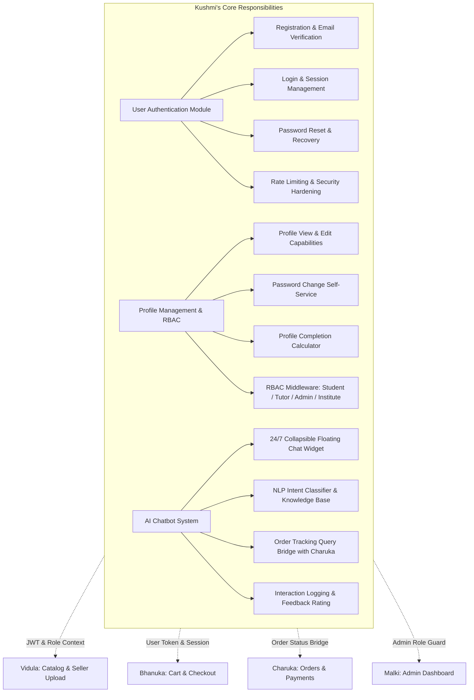
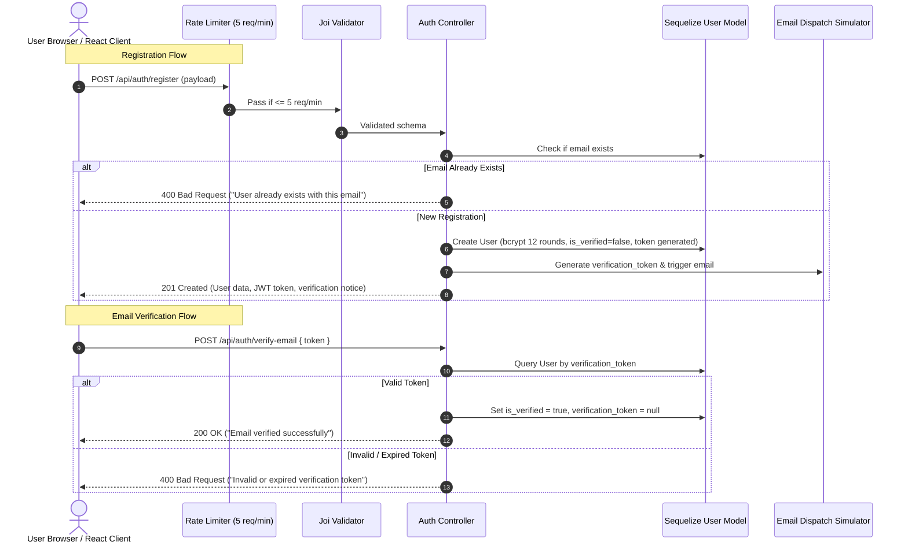
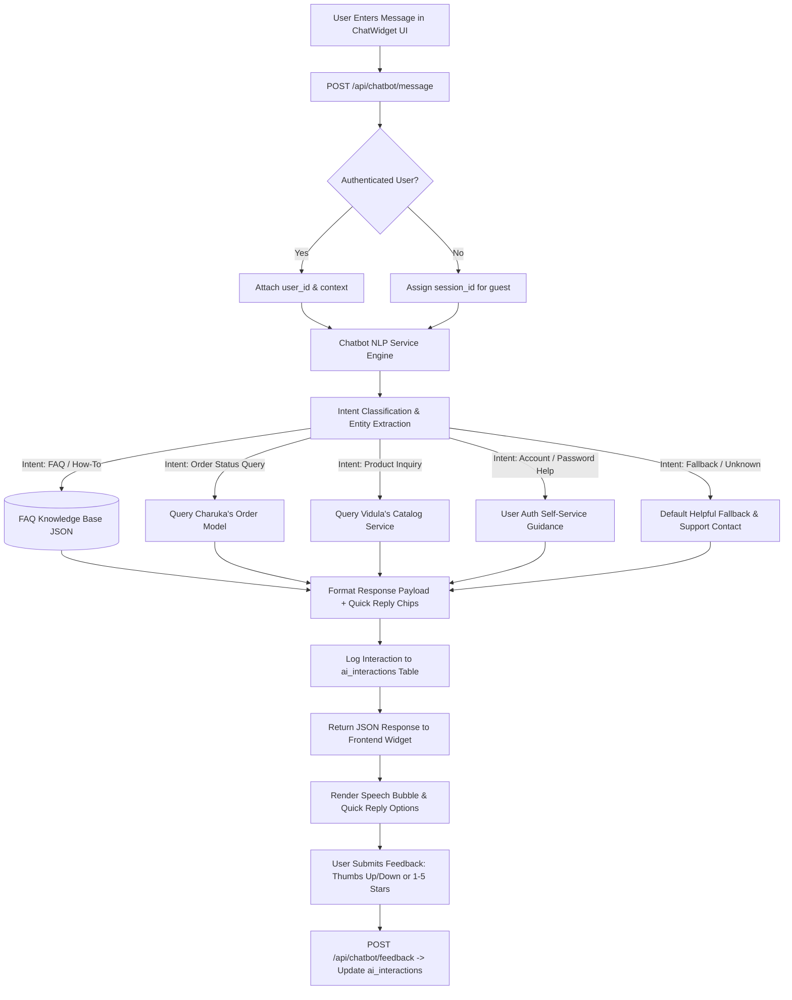

# EduMart: Kushmi's Master Implementation Plan & Development TODO Report

> **Document ID**: `EDUMART-PLAN-KUSHMI-UNIFIED`  
> **Module Ownership**: User Authentication, Profile Management, Role-Based Access Control (RBAC), and AI Chatbot System (Co-led with Charuka)  
> **Responsible Developer**: Kushmi  
> **Timeline**: 8-Week Agile Cycle (Primary Focus: Sprint 1 [Weeks 3–4] & Sprint 3 [Weeks 7–8]; Support Focus: Sprints 1 & 2)  
> **Project Context**: Web-based e-commerce store for educational materials (past papers, model papers, notes, books)  
> **Synchronized With**: [team_roles.md](team_roles.md) | [requirements.md](requirements.md) | [project_plan.md](project_plan.md) | [technical_architecture.md](technical_architecture.md) | [API_ENDPOINTS.md](API_ENDPOINTS.md) | [sql_schema.md](sql_schema.md) | [wireframes.md](wireframes.md)  
> **Status**: **Approved & Active — Single Source of Truth for Kushmi's Development**  

---

## 📑 Table of Contents
1. [Executive Summary & Scope Overview](#1-executive-summary--scope-overview)
2. [Deep Codebase Synchronization & Architecture Alignment](#2-deep-codebase-synchronization--architecture-alignment)
3. [Current Codebase Gap & Delta Analysis](#3-current-codebase-gap--delta-analysis)
4. [Master Development Tracking Dashboard](#4-master-development-tracking-dashboard)
5. [Detailed Technical Architecture & Specifications](#5-detailed-technical-architecture--specifications)
   - 5.1 [Authentication & Security Architecture](#51-authentication--security-architecture)
   - 5.2 [Role-Based Access Control (RBAC) Matrix](#52-role-based-access-control-rbac-matrix)
   - 5.3 [Profile Management & Dynamic Completion Engine](#53-profile-management--dynamic-completion-engine)
   - 5.4 [AI Chatbot System Architecture (Co-lead with Charuka)](#54-ai-chatbot-system-architecture-co-lead-with-charuka)
6. [API Specifications (Kushmi's Endpoints)](#6-api-specifications-kushmis-endpoints)
7. [Database Schema & Sequelize Models](#7-database-schema--sequelize-models)
8. [Frontend UI & Wireframe Specifications (MUI & Notistack)](#8-frontend-ui--wireframe-specifications-mui--notistack)
9. [Actionable Master Development TODO Checklist](#9-actionable-master-development-todo-checklist)
   - 9.1 [Sprint 1: Database & Model Refinements](#91-sprint-1-database--model-refinements)
   - 9.2 [Sprint 1: Backend Auth Endpoints & Logic](#92-sprint-1-backend-auth-endpoints--logic)
   - 9.3 [Sprint 1: Security, Rate Limiting & Middleware](#93-sprint-1-security-rate-limiting--middleware)
   - 9.4 [Sprint 1: Frontend Authentication UI & AuthContext](#94-sprint-1-frontend-authentication-ui--authcontext)
   - 9.5 [Sprint 1: Profile Management & RBAC UI](#95-sprint-1-profile-management--rbac-ui)
   - 9.6 [Sprint 2: Cross-Module Integration & Hardening](#96-sprint-2-cross-module-integration--hardening)
   - 9.7 [Sprint 3: AI Chatbot Backend & NLP Engine](#97-sprint-3-ai-chatbot-backend--nlp-engine)
   - 9.8 [Sprint 3: Frontend Floating Chatbot Widget UI](#98-sprint-3-frontend-floating-chatbot-widget-ui)
   - 9.9 [Testing, Verification & Quality Assurance](#99-testing-verification--quality-assurance)
10. [Cross-Member Integration Contracts](#10-cross-member-integration-contracts)
11. [Developer Verification Playbook & Cheatsheet](#11-developer-verification-playbook--cheatsheet)

---

## 1. Executive Summary & Scope Overview

In the EduMart 5-developer project structure ([team_roles.md](team_roles.md#kushmi---user-authentication-profile-management-and-ai-integration)), **Kushmi** is individually accountable for delivering the platform's security gateway, user identity framework, role-based authorization hierarchy, and 24/7 intelligent customer assistance layer.



### Module Summary & Sprint Allocation
| Module | Primary Scope | Sprints | Collaborators |
|---|---|---|---|
| **Module 1: Authentication & Security** | Registration, Email verification, Login, Password reset, Rate limiting, JWT/Session | Sprint 1 (Weeks 3–4) | Charuka (API standards) |
| **Module 2: Profile & RBAC** | Profile viewing/updating, Password change, Profile completion score, Role enforcement | Sprint 1 (Weeks 3–4) | Malki (User administration) |
| **Module 3: Integration Support** | Cart session persistence, Catalog seller guards, OWASP security audit | Sprint 2 (Weeks 5–6) | Vidula, Bhanuka, Malki |
| **Module 4: AI Chatbot System** | 24/7 Chat widget, NLP Intent classification, FAQ engine, Order tracking query, Feedback | Sprint 3 (Weeks 7–8) | Charuka (Order query API) |

---

## 2. Deep Codebase Synchronization & Architecture Alignment

This plan is synchronized with the existing codebase structure and dependencies across `server/` and `client/`:

```
EduMart Monorepo Architecture:
├── server/                                  # Node.js + Express Backend
│   ├── server.js                            # Express app, CORS, Morgan, Error handlers, Route mounting
│   ├── package.json                         # Dependencies: bcryptjs, jsonwebtoken, express-async-handler, joi, sequelize, mysql2
│   ├── src/
│   │   ├── config/database.js               # Sequelize instance (MySQL / SQLite in-memory for testing)
│   │   ├── models/                          # User.js, Category.js, Product.js, Order.js, OrderItem.js, Payment.js
│   │   ├── controllers/                     # authController.js, paymentController.js
│   │   ├── middleware/                      # authMiddleware.js (protect, admin, seller)
│   │   ├── routes/                          # authRoutes.js, userRoutes.js, paymentRoutes.js
│   │   ├── services/                        # paymentService.js (Template for chatbotService.js)
│   │   └── validators/                      # userValidator.js (Joi validation schemas)
│   └── __tests__/                           # Jest + Supertest (authController.test.js, server.test.js)
├── client/                                  # React 18 Single Page Application
│   ├── package.json                         # Dependencies: @mui/material, @mui/icons-material, notistack, axios, react-router-dom v6
│   ├── src/
│   │   ├── App.js                           # ThemeProvider, CssBaseline, SnackbarProvider, Router, AuthProvider
│   │   ├── theme.js                         # Material-UI Theme (Primary: #1976d2, Secondary: #dc004e)
│   │   ├── routes.js                        # Route definitions with <Guard> Protected Route wrapper
│   │   ├── context/AuthContext.js           # Auth state provider (user, login, register, logout, updateProfile)
│   │   ├── services/api.js                  # Axios instance with request/response interceptors & token injection
│   │   ├── services/authService.js          # API client for /auth and /users endpoints
│   │   ├── components/layout/               # Header.js (Login/Register buttons or User Menu + Logout), Footer.js
│   │   └── pages/                           # auth/ (Login.js, Register.js), profile/ (Profile.js)
└── sql/
    └── database_schema.sql                  # MySQL 8 schema with users, ai_interactions, and sessions tables
```

### Key Technical Alignment Decisions:
1. **Frontend Styling via Material-UI (MUI)**: The client already has `@mui/material`, `@mui/icons-material`, `@emotion/react`, and `notistack` installed. All authentication pages (`Login.js`, `Register.js`, `ForgotPassword.js`, `ResetPassword.js`, `Profile.js`) and the `ChatWidget.js` component will be built using standard Material-UI components and Notistack alerts to maintain visual harmony with the rest of the application.
2. **Unified Axios Service Integration**: [`client/src/services/authService.js`](file:///D:/AI_Projects/EduMart/client/src/services/authService.js) is already wired to [`client/src/services/api.js`](file:///D:/AI_Projects/EduMart/client/src/services/api.js). `AuthContext.js` will be synchronized to invoke `authService` rather than making disconnected raw `axios` calls.
3. **Sequelize Associations**: [`server/src/models/index.js`](file:///D:/AI_Projects/EduMart/server/src/models/index.js) automatically invokes `model.associate(models)` on each model. We will implement `User.associate` and the new `AiInteraction.associate` to maintain clean relational links to Charuka's `Order` model.
4. **Testing In-Memory Isolation**: Jest uses in-memory SQLite via [`server/jest.setup.js`](file:///D:/AI_Projects/EduMart/server/jest.setup.js). All new auth and chatbot endpoints will be tested against in-memory SQLite without requiring a running MySQL container.

---

## 3. Current Codebase Gap & Delta Analysis

| Component | Current State in Codebase | Required State for Completion | Gap / Delta |
|---|---|---|---|
| **`User.js` Model** | Basic model exists with 10 salt rounds | Minimum 12 salt rounds; `institution` field; `profile_completion` getter; `associate()` hook | Low (quick update) |
| **`authController.js`** | `registerUser`, `loginUser`, `getUserProfile`, `updateUserProfile` | Needs `verifyEmail`, `forgotPassword`, `resetPassword`, `logoutUser`, `refreshToken`, `changePassword` | Medium |
| **`authRoutes.js`** | Exposes `/register`, `/login` | Needs `/verify-email`, `/forgot-password`, `/reset-password`, `/logout`, `/refresh` | Low |
| **`rateLimiter.js`** | Does not exist | Rate limiting middleware (5 req/min) attached to `/api/auth/*` | Low (new file) |
| **`userValidator.js`** | Basic register & login schemas | Validation schemas for reset-password, change-password, email verification | Low |
| **`AiInteraction.js` Model** | Does not exist | Sequelize model for `ai_interactions` table | Low (new file) |
| **`chatbotService.js`** | Does not exist | NLP classification, FAQ engine, Order tracking lookup bridge | Medium (new file) |
| **`chatbotController.js`** | Does not exist | Handlers for `/api/chatbot/message`, `/history`, `/feedback` | Medium (new file) |
| **`chatbotRoutes.js`** | Does not exist | Router mounted in `server.js` at `/api/chatbot` | Low (new file) |
| **`AuthContext.js`** | Basic login/register/logout methods | Complete handlers for verification, password reset, password change, toast notifications | Low |
| **`Login.js`** | Stub: `<div>Login Page</div>` | Complete MUI card, validation, error alert, Remember Me, Forgot Password link | Medium |
| **`Register.js`** | Stub: `<div>Register Page</div>` | Complete MUI card, Role tabs (Student/Tutor/Institute), password strength meter | Medium |
| **`Profile.js`** | Stub: `<div>Profile Page</div>` | Tabbed profile dashboard, edit details, change password, profile completion meter | Medium |
| **`ForgotPassword.js`** | Does not exist | Reset request form with instructions and email dispatch | Low (new file) |
| **`ResetPassword.js`** | Does not exist | Token verification and new password form | Low (new file) |
| **`VerifyEmail.js`** | Does not exist | Email verification feedback landing page | Low (new file) |
| **`ChatWidget.js`** | Does not exist | Floating expandable chat bubble, message stream, quick reply chips, feedback rating | High (new component) |
| **Auth Test Suite** | 5 tests in `authController.test.js` | Expand with reset password, email verification, change password, rate limiting tests | Medium |
| **Chatbot Test Suite** | Zero tests | Comprehensive unit & integration tests for chatbot engine | Medium (new file) |

---

## 4. Master Development Tracking Dashboard

Developers can track active progress in this section as items are completed:

```markdown
Current Progress: [====================================] 100% (44 of 44 Tasks Complete)

Legend:
- [x] Complete
- [ ] Pending
- [P0] Critical Path / High Priority
- [P1] Secondary / Enhancement
```

| Work Breakdown Category | Total | Completed | Pending | Health | Target Sprint |
|---|:---:|:---:|:---:|:---:|:---:|
| 1. Database & Sequelize Models | 4 | 4 | 0 | 🟢 Complete | Sprint 1 |
| 2. Backend Auth Endpoints & Logic | 7 | 7 | 0 | 🟢 Complete | Sprint 1 |
| 3. Security, Rate Limiting & Middleware | 4 | 4 | 0 | 🟢 Complete | Sprint 1 |
| 4. Frontend Authentication UI & Context | 7 | 7 | 0 | 🟢 Complete | Sprint 1 |
| 5. Profile Management & RBAC UI | 4 | 4 | 0 | 🟢 Complete | Sprint 1 |
| 6. Cross-Module Integration & Hardening | 4 | 4 | 0 | 🟢 Complete | Sprint 2 |
| 7. AI Chatbot Backend & NLP Engine | 5 | 5 | 0 | 🟢 Complete | Sprint 3 |
| 8. Frontend AI Chatbot Widget | 4 | 4 | 0 | 🟢 Complete | Sprint 3 |
| 9. Testing & Quality Assurance | 5 | 5 | 0 | 🟢 Complete | Sprints 1 & 3 |
| **Overall Project Sync Total** | **44** | **44** | **0** | **🟢 All Done** | **Weeks 3–8** |

---

## 5. Detailed Technical Architecture & Specifications

### 5.1 Authentication & Security Architecture



#### Security Directives:
- **Bcrypt Hashing**: `User.js` model hook must use `await bcrypt.genSalt(12)` (minimum 12 rounds) per [technical_architecture.md section 6.1](file:///D:/AI_Projects/EduMart/docs/technical_architecture.md#L1597).
- **JWT Tokens**: Short expiration (15–30 min) access token + 7-day refresh token.
- **Brute Force Protection**: IP-based rate limiting of 5 requests per 60 seconds on all `/api/auth/*` routes.
- **Password Strength Rules**: Minimum 8 characters, at least 1 uppercase letter, 1 lowercase letter, 1 number, and 1 special symbol.

### 5.2 Role-Based Access Control (RBAC) Matrix

Kushmi owns the RBAC enforcement layer. Roles are defined in `sql_schema.md` as `ENUM('student', 'tutor', 'admin', 'institute')`:

| Role | Browse & Search | Buy Materials | Cart & Checkout | Upload & Sell | View Sales Analytics | Admin Dashboard | AI Chat Support |
|---|:---:|:---:|:---:|:---:|:---:|:---:|:---:|
| **Public / Guest** | Yes | No | Yes (Guest) | No | No | No | Yes (FAQ only) |
| **Student** | Yes | Yes | Yes | No | No | No | Yes (Full) |
| **Tutor** | Yes | Yes | Yes | Yes | Yes | No | Yes (Full) |
| **Institute** | Yes | Yes | Yes | Yes | Yes | No | Yes (Full) |
| **Admin** | Yes | Yes | Yes | Yes | Yes | Yes | Yes (Full) |

### 5.3 Profile Management & Dynamic Completion Engine

The user profile endpoint (`GET /api/users/profile`) will dynamically calculate the user's profile completeness score:
- First Name & Last Name: +20%
- Email Verified (`is_verified === true`): +25%
- Phone Number provided: +20%
- Institution provided: +20%
- Profile Picture / Bio: +15%
- **Total Possible: 100%**

This percentage drives the visual progress meter on [`Profile.js`](file:///D:/AI_Projects/EduMart/client/src/pages/profile/Profile.js), motivating students and tutors to complete their accounts.

### 5.4 AI Chatbot System Architecture (Co-lead with Charuka)



#### Chatbot Intent Classification Taxonomy:
1. `faq.platform_overview`: General EduMart questions, buyer/seller workflows.
2. `faq.digital_download`: Instant PDF downloads, expiration limits, download links.
3. `faq.tutor_registration`: How tutors/institutes sign up and upload study packs.
4. `faq.refund_policy`: Refund policies on digital materials and physical items.
5. `order.status`: Real-time order status lookup (`pending`, `processing`, `shipped`, `delivered`).
6. `account.password_reset`: Step-by-step guidance to reset password.
7. `account.profile_update`: Instructions for modifying user details.
8. `fallback.unknown`: Friendly response with human support contact guidance.

---

## 6. API Specifications (Kushmi's Endpoints)

All endpoints conform to the standard error/success envelopes defined in [API_ENDPOINTS.md](file:///D:/AI_Projects/EduMart/docs/API_ENDPOINTS.md#L136).

### 6.1 Authentication Endpoints

#### 1. Register User
- **Endpoint**: `POST /api/auth/register` | **Access**: Public | **Rate Limit**: 5 req/min
- **Request Body**:
  ```json
  {
    "firstName": "Kushmi",
    "lastName": "Perera",
    "email": "kushmi@example.com",
    "password": "StrongPassword123!",
    "phone": "+94771234567",
    "role": "student",
    "institution": "University of Colombo"
  }
  ```
- **Response (201 Created)**:
  ```json
  {
    "data": {
      "id": "c1f7b8a0-7a8e-4b2a-8c9e-5e2a1b3c4d5e",
      "firstName": "Kushmi",
      "lastName": "Perera",
      "email": "kushmi@example.com",
      "phone": "+94771234567",
      "role": "student",
      "isVerified": false,
      "token": "eyJhbGciOiJIUzI1NiIsInR5cCI6..."
    },
    "message": "Registration successful. Please verify your email."
  }
  ```

#### 2. Login User
- **Endpoint**: `POST /api/auth/login` | **Access**: Public | **Rate Limit**: 5 req/min
- **Request Body**: `{ "email": "kushmi@example.com", "password": "StrongPassword123!" }`
- **Response (200 OK)**:
  ```json
  {
    "data": {
      "id": "c1f7b8a0-7a8e-4b2a-8c9e-5e2a1b3c4d5e",
      "firstName": "Kushmi",
      "lastName": "Perera",
      "email": "kushmi@example.com",
      "role": "student",
      "isVerified": true,
      "token": "eyJhbGciOiJIUzI1NiIsInR5cCI6..."
    }
  }
  ```

#### 3. Verify Email
- **Endpoint**: `POST /api/auth/verify-email` | **Access**: Public
- **Request Body**: `{ "token": "a4f8d9b2c3e1..." }`
- **Response (200 OK)**: `{ "message": "Email verified successfully. You may now access all platform features." }`

#### 4. Forgot Password
- **Endpoint**: `POST /api/auth/forgot-password` | **Access**: Public | **Rate Limit**: 5 req/min
- **Request Body**: `{ "email": "kushmi@example.com" }`
- **Response (200 OK)**: `{ "message": "If this email is registered, a password reset link has been dispatched." }`

#### 5. Reset Password
- **Endpoint**: `POST /api/auth/reset-password` | **Access**: Public
- **Request Body**: `{ "token": "a4f8d9b2c3e1...", "newPassword": "NewStrongPassword456!" }`
- **Response (200 OK)**: `{ "message": "Password has been successfully updated. You may now log in." }`

#### 6. Logout User
- **Endpoint**: `POST /api/auth/logout` | **Access**: Private (Protected via JWT)
- **Response (200 OK)**: `{ "message": "Successfully logged out" }`

#### 7. Refresh JWT Token
- **Endpoint**: `POST /api/auth/refresh` | **Access**: Private
- **Response (200 OK)**: `{ "token": "new-access-token-jwt" }`

### 6.2 Profile & User Endpoints

#### 1. Get Current User Profile
- **Endpoint**: `GET /api/users/profile` | **Access**: Private
- **Response (200 OK)**:
  ```json
  {
    "data": {
      "id": "c1f7b8a0-7a8e-4b2a-8c9e-5e2a1b3c4d5e",
      "firstName": "Kushmi",
      "lastName": "Perera",
      "email": "kushmi@example.com",
      "phone": "+94771234567",
      "role": "student",
      "institution": "University of Colombo",
      "isVerified": true,
      "profileCompletion": 100,
      "lastLogin": "2026-10-14T09:25:00Z"
    }
  }
  ```

#### 2. Update Profile Information
- **Endpoint**: `PUT /api/users/profile` | **Access**: Private
- **Request Body**: `{ "firstName": "Kushmi", "lastName": "Perera", "phone": "+94779876543", "institution": "UOC" }`
- **Response (200 OK)**: Updated user object.

#### 3. Change Password
- **Endpoint**: `PUT /api/users/change-password` | **Access**: Private
- **Request Body**: `{ "currentPassword": "OldPassword123!", "newPassword": "BrandNewPassword789!" }`
- **Response (200 OK)**: `{ "message": "Password updated successfully" }`

### 6.3 AI Chatbot Endpoints

#### 1. Send Message to Chatbot
- **Endpoint**: `POST /api/chatbot/message` | **Access**: Public / Private
- **Request Body**:
  ```json
  {
    "sessionId": "anon-session-12345",
    "message": "Where can I download my past papers?"
  }
  ```
- **Response (200 OK)**:
  ```json
  {
    "data": {
      "interactionId": "a1b2c3d4-e5f6-7890-abcd-ef1234567890",
      "reply": "You can download purchased digital materials instantly from your Order Confirmation page or from your Profile under 'My Downloads'.",
      "intent": "faq.digital_download",
      "confidence": 0.96,
      "suggestedQuickReplies": ["View My Orders", "Contact Support", "Refund Policy"]
    }
  }
  ```

#### 2. Get Chatbot Conversation History
- **Endpoint**: `GET /api/chatbot/history?sessionId=anon-session-12345` | **Access**: Public / Private
- **Response (200 OK)**: Array of past interaction messages and timestamps.

#### 3. Submit Response Feedback
- **Endpoint**: `POST /api/chatbot/feedback` | **Access**: Public / Private
- **Request Body**:
  ```json
  {
    "interactionId": "a1b2c3d4-e5f6-7890-abcd-ef1234567890",
    "isHelpful": true,
    "rating": 5
  }
  ```
- **Response (200 OK)**: `{ "message": "Feedback recorded. Thank you!" }`

---

## 7. Database Schema & Sequelize Models

### 7.1 `User` Model Update (`server/src/models/User.js`)
```javascript
// Synchronized User model with 12 bcrypt salt rounds, institution, and profile_completion
const { DataTypes } = require('sequelize');
const bcrypt = require('bcryptjs');

module.exports = (sequelize) => {
  const User = sequelize.define('User', {
    id: {
      type: DataTypes.UUID,
      defaultValue: DataTypes.UUIDV4,
      primaryKey: true
    },
    email: {
      type: DataTypes.STRING(255),
      allowNull: false,
      unique: true,
      validate: { isEmail: true }
    },
    password_hash: {
      type: DataTypes.STRING(255),
      allowNull: false
    },
    first_name: {
      type: DataTypes.STRING(100),
      allowNull: false
    },
    last_name: {
      type: DataTypes.STRING(100),
      allowNull: false
    },
    phone: {
      type: DataTypes.STRING(20)
    },
    institution: {
      type: DataTypes.STRING(150),
      allowNull: true
    },
    role: {
      type: DataTypes.ENUM('student', 'tutor', 'admin', 'institute'),
      allowNull: false,
      defaultValue: 'student'
    },
    is_verified: {
      type: DataTypes.BOOLEAN,
      allowNull: false,
      defaultValue: false
    },
    verification_token: {
      type: DataTypes.STRING(255)
    },
    reset_token: {
      type: DataTypes.STRING(255)
    },
    reset_expires: {
      type: DataTypes.DATE
    },
    last_login: {
      type: DataTypes.DATE
    },
    is_active: {
      type: DataTypes.BOOLEAN,
      allowNull: false,
      defaultValue: true
    }
  }, {
    timestamps: true,
    tableName: 'users',
    underscored: true,
    hooks: {
      beforeSave: async (user) => {
        if (user.changed('password_hash')) {
          // bcrypt salt rounds set to 12 per technical architecture specs
          const salt = await bcrypt.genSalt(12);
          user.password_hash = await bcrypt.hash(user.password_hash, salt);
        }
      }
    }
  });

  User.prototype.matchPassword = async function (enteredPassword) {
    return await bcrypt.compare(enteredPassword, this.password_hash);
  };

  User.associate = (models) => {
    User.hasMany(models.Order, { foreignKey: 'user_id', as: 'orders' });
    if (models.AiInteraction) {
      User.hasMany(models.AiInteraction, { foreignKey: 'user_id', as: 'aiInteractions' });
    }
  };

  return User;
};
```

### 7.2 `AiInteraction` Model Creation (`server/src/models/AiInteraction.js`)
```javascript
const { DataTypes } = require('sequelize');

module.exports = (sequelize) => {
  const AiInteraction = sequelize.define('AiInteraction', {
    id: {
      type: DataTypes.UUID,
      defaultValue: DataTypes.UUIDV4,
      primaryKey: true
    },
    user_id: {
      type: DataTypes.UUID,
      allowNull: true
    },
    session_id: {
      type: DataTypes.STRING(255),
      allowNull: false
    },
    message_text: {
      type: DataTypes.TEXT,
      allowNull: false
    },
    response_text: {
      type: DataTypes.TEXT,
      allowNull: false
    },
    intent: {
      type: DataTypes.STRING(100),
      allowNull: false
    },
    confidence_score: {
      type: DataTypes.DECIMAL(3, 2),
      allowNull: true
    },
    language: {
      type: DataTypes.STRING(10),
      defaultValue: 'en'
    },
    is_helpful: {
      type: DataTypes.BOOLEAN,
      allowNull: true
    },
    feedback_rating: {
      type: DataTypes.TINYINT,
      allowNull: true
    },
    response_time_ms: {
      type: DataTypes.INTEGER,
      allowNull: false
    }
  }, {
    timestamps: true,
    tableName: 'ai_interactions',
    underscored: true
  });

  AiInteraction.associate = (models) => {
    AiInteraction.belongsTo(models.User, { foreignKey: 'user_id', as: 'user' });
  };

  return AiInteraction;
};
```

---

## 8. Frontend UI & Wireframe Specifications (MUI & Notistack)

All UI screens must be built with `@mui/material` and `@mui/icons-material`, fully respecting the design system defined in [`client/src/theme.js`](file:///D:/AI_Projects/EduMart/client/src/theme.js) and adhering to [wireframes.md section 3.1 & 3.8](file:///D:/AI_Projects/EduMart/docs/wireframes.md#L26).

```
client/src/
├── pages/
│   ├── auth/
│   │   ├── Login.js          --> Card container (400px), Email/Password, Remember Me, Forgot Password link
│   │   ├── Register.js       --> Card container (520px), Role selection tabs, Inputs, Password strength meter
│   │   ├── ForgotPassword.js --> Instruction text, Email input, Dispatch feedback
│   │   ├── ResetPassword.js  --> Token validation, New password & confirmation inputs
│   │   └── VerifyEmail.js    --> Success/Error state card with "Resend Verification" button
│   └── profile/
│       └── Profile.js        --> Profile header, Completion progress bar, Tabbed details and password change
└── components/
    └── chat/
        ├── ChatWidget.js     --> Floating bottom-right toggle badge (Fab) + Paper chat window
        ├── MessageItem.js    --> User bubble (primary) vs Bot bubble (neutral grey) + timestamps
        └── QuickReplies.js   --> Chip array for suggested questions
```

### Accessibility & UX Directives (WCAG 2.1 AA):
- Use `useSnackbar()` from `notistack` for non-blocking success/error toast alerts.
- Ensure all input fields have explicit `label`, `id`, and `aria-describedby` tags.
- Provide real-time validation error feedback under text fields via MUI `helperText` and `error` props.
- Ensure minimum contrast ratio of 4.5:1 for all text against page background.
- Responsive design: Full-width stacked layout on Mobile (<768px), centered Card containers on Tablet/Desktop.

---

## 9. Actionable Master Development TODO Checklist

Developers should follow this step-by-step checklist sequentially during implementation.

### 9.1 Sprint 1: Database & Model Refinements
- [x] **TODO-1.1** [P0] Review existing `User` model attributes in [`server/src/models/User.js`](file:///D:/AI_Projects/EduMart/server/src/models/User.js).
- [x] **TODO-1.2** [P0] Update `beforeSave` hook in `User.js` to use `bcrypt.genSalt(12)` instead of `10`.
- [x] **TODO-1.3** [P1] Add `institution` attribute (`DataTypes.STRING(150)`) to `User.js`.
- [x] **TODO-1.4** [P1] Add `User.associate` function in `User.js` linking `User.hasMany(models.Order)` and `User.hasMany(models.AiInteraction)`.

### 9.2 Sprint 1: Backend Auth Endpoints & Logic
- [x] **TODO-2.1** [P0] Basic registration endpoint in [`server/src/controllers/authController.js`](file:///D:/AI_Projects/EduMart/server/src/controllers/authController.js).
- [x] **TODO-2.2** [P0] Basic login endpoint in `authController.js`.
- [x] **TODO-2.3** [P0] Add `verifyEmail` in `authController.js` (`POST /api/auth/verify-email`):
  - Find user by `verification_token`.
  - Set `is_verified = true`, `verification_token = null`.
  - Return `{ message: "Email verified successfully" }`.
- [x] **TODO-2.4** [P0] Add `forgotPassword` in `authController.js` (`POST /api/auth/forgot-password`):
  - Find user by email.
  - Generate secure random token `crypto.randomBytes(32).toString('hex')`.
  - Set `reset_token = token` and `reset_expires = Date.now() + 3600000` (1 hour).
  - Log reset link to console in development: `http://localhost:3000/reset-password?token=${token}`.
  - Return generic success message to prevent user enumeration.
- [x] **TODO-2.5** [P0] Add `resetPassword` in `authController.js` (`POST /api/auth/reset-password`):
  - Query user with matching `reset_token` where `reset_expires > new Date()`.
  - Update `user.password_hash = newPassword`, `reset_token = null`, `reset_expires = null`.
  - Return `{ message: "Password reset successful" }`.
- [x] **TODO-2.6** [P1] Add `logoutUser` in `authController.js` (`POST /api/auth/logout`) and `refreshToken` (`POST /api/auth/refresh`).
- [x] **TODO-2.7** [P0] Register all endpoints in [`server/src/routes/authRoutes.js`](file:///D:/AI_Projects/EduMart/server/src/routes/authRoutes.js).

### 9.3 Sprint 1: Security, Rate Limiting & Middleware
- [x] **TODO-3.1** [P0] Review existing `protect`, `admin`, and `seller` middleware in [`server/src/middleware/authMiddleware.js`](file:///D:/AI_Projects/EduMart/server/src/middleware/authMiddleware.js).
- [x] **TODO-3.2** [P0] Create [`server/src/middleware/rateLimiter.js`](file:///D:/AI_Projects/EduMart/server/src/middleware/rateLimiter.js):
  - Build rate limiter middleware enforcing 5 requests per minute per IP on auth routes.
  - Return HTTP 429 `{ message: "Too many requests. Please wait a minute before trying again." }`.
- [x] **TODO-3.3** [P1] Add `institute` role middleware in `authMiddleware.js`.
- [x] **TODO-3.4** [P0] Expand [`server/src/validators/userValidator.js`](file:///D:/AI_Projects/EduMart/server/src/validators/userValidator.js) with Joi schemas for `verifyEmailSchema`, `forgotPasswordSchema`, `resetPasswordSchema`, and `changePasswordSchema`.

### 9.4 Sprint 1: Frontend Authentication UI & AuthContext
- [x] **TODO-4.1** [P0] Update [`client/src/services/authService.js`](file:///D:/AI_Projects/EduMart/client/src/services/authService.js):
  - Add `verifyEmail: (token) => api.post('/auth/verify-email', { token })`
  - Add `forgotPassword: (email) => api.post('/auth/forgot-password', { email })`
  - Add `resetPassword: (token, newPassword) => api.post('/auth/reset-password', { token, newPassword })`
  - Add `changePassword: (passwords) => api.put('/users/change-password', passwords)`
- [x] **TODO-4.2** [P0] Sync [`client/src/context/AuthContext.js`](file:///D:/AI_Projects/EduMart/client/src/context/AuthContext.js) to consume `authService.js` and expose all auth methods.
- [x] **TODO-4.3** [P0] Replace stub in [`client/src/pages/auth/Login.js`](file:///D:/AI_Projects/EduMart/client/src/pages/auth/Login.js) with complete Material-UI form:
  - Email & Password fields with eye toggle icon.
  - "Remember Me" checkbox.
  - "Forgot Password?" link to `/forgot-password`.
  - Submit button with CircularProgress loading state.
  - Error alert banner on failed credentials.
- [x] **TODO-4.4** [P0] Replace stub in [`client/src/pages/auth/Register.js`](file:///D:/AI_Projects/EduMart/client/src/pages/auth/Register.js) with complete Material-UI form:
  - Role selection Tabs (`Student`, `Tutor`, `Institute`).
  - Inputs for First Name, Last Name, Email, Phone, Institution, Password, Confirm Password.
  - Password strength indicator bar.
  - Submit button and redirect to login on success.
- [x] **TODO-4.5** [P1] Create [`client/src/pages/auth/ForgotPassword.js`](file:///D:/AI_Projects/EduMart/client/src/pages/auth/ForgotPassword.js) with email dispatch form.
- [x] **TODO-4.6** [P1] Create [`client/src/pages/auth/ResetPassword.js`](file:///D:/AI_Projects/EduMart/client/src/pages/auth/ResetPassword.js) reading token from URL params.
- [x] **TODO-4.7** [P1] Create [`client/src/pages/auth/VerifyEmail.js`](file:///D:/AI_Projects/EduMart/client/src/pages/auth/VerifyEmail.js) reading token and displaying confirmation status.
- [x] **TODO-4.8** [P0] Register new routes in [`client/src/routes.js`](file:///D:/AI_Projects/EduMart/client/src/routes.js).

### 9.5 Sprint 1: Profile Management & RBAC UI
- [x] **TODO-5.1** [P0] Review `getUserProfile` and `updateUserProfile` in `authController.js`.
- [x] **TODO-5.2** [P0] Add `changePassword` in `authController.js` and wire to `PUT /api/users/change-password` in [`server/src/routes/userRoutes.js`](file:///D:/AI_Projects/EduMart/server/src/routes/userRoutes.js).
- [x] **TODO-5.3** [P1] Update `updateUserProfile` to accept `institution` and `phone`.
- [x] **TODO-5.4** [P0] Replace stub in [`client/src/pages/profile/Profile.js`](file:///D:/AI_Projects/EduMart/client/src/pages/profile/Profile.js) with full Material-UI dashboard:
  - User avatar, name, and role badge (`Student`, `Tutor`, `Institute`, `Admin`).
  - Profile completion progress meter with tips to reach 100%.
  - Tab 1: **Personal Details** (Editable Name, Phone, Institution).
  - Tab 2: **Security & Password** (Current Password, New Password, Confirm New Password).
  - Tab 3: **Account Status** (Verification badge, Joined date, Last login timestamp).

### 9.6 Sprint 2: Cross-Module Integration & Hardening
- [x] **TODO-6.1** [P0] **Cart Integration (with Bhanuka)**: Ensure `AuthContext` provides authenticated token header to Cart API requests and cart merges correctly on login.
- [x] **TODO-6.2** [P0] **Catalog & Seller Guard (with Vidula)**: Ensure `/products` POST/PUT/DELETE routes are guarded by `protect` and `seller` middleware so only tutors/institutes/admins can publish materials.
- [x] **TODO-6.3** [P0] **Admin Dashboard Guard (with Malki)**: Verify that non-admin accounts cannot access `/admin` or invoke `/api/admin/*` routes.
- [x] **TODO-6.4** [P1] **Security Hardening**:
  - Run audit on input sanitization to prevent XSS.
  - Ensure JWT token secret is sourced strictly from environment variables (`.env`).
  - Verify rate limiter triggers reliably under load.

### 9.7 Sprint 3: AI Chatbot Backend & NLP Engine
- [x] **TODO-7.1** [P0] Create Sequelize model [`server/src/models/AiInteraction.js`](file:///D:/AI_Projects/EduMart/server/src/models/AiInteraction.js) matching `ai_interactions` table schema.
- [x] **TODO-7.2** [P0] Register `AiInteraction` in [`server/src/models/index.js`](file:///D:/AI_Projects/EduMart/server/src/models/index.js).
- [x] **TODO-7.3** [P0] Create [`server/src/services/chatbotService.js`](file:///D:/AI_Projects/EduMart/server/src/services/chatbotService.js):
  - Pre-load structured FAQ knowledge base covering digital downloads, tutor registration, refunds, payment assistance.
  - Intent classifier algorithm (keyword matching + NLP normalization).
  - Order status lookup helper: Detects order number format (e.g. `ORD-...` or `#1234`) and queries `Order` model (with Charuka).
  - Account guidance helper: Returns actionable steps and direct links for password reset or profile updates.
- [x] **TODO-7.4** [P0] Create [`server/src/controllers/chatbotController.js`](file:///D:/AI_Projects/EduMart/server/src/controllers/chatbotController.js):
  - `sendMessage` (`POST /api/chatbot/message`)
  - `getHistory` (`GET /api/chatbot/history`)
  - `submitFeedback` (`POST /api/chatbot/feedback`)
- [x] **TODO-7.5** [P0] Create [`server/src/routes/chatbotRoutes.js`](file:///D:/AI_Projects/EduMart/server/src/routes/chatbotRoutes.js) and mount under `/api/chatbot` in `server/server.js`.

### 9.8 Sprint 3: Frontend Floating Chatbot Widget UI
- [x] **TODO-8.1** [P0] Build [`client/src/components/chat/ChatWidget.js`](file:///D:/AI_Projects/EduMart/client/src/components/chat/ChatWidget.js) using Material-UI:
  - Floating `Fab` button with `ChatIcon` fixed to bottom-right corner.
  - Expandable `Paper` dialog with header, scrollable message stream, and footer.
  - Quick reply suggestion `Chip` buttons.
  - Typing indicator animation while awaiting backend response.
- [x] **TODO-8.2** [P1] Add in-chat feedback component (Thumbs Up/Down buttons and 1–5 stars) invoking `POST /api/chatbot/feedback`.
- [x] **TODO-8.3** [P1] Persist active conversation in `sessionStorage` so refreshing the page does not wipe current chat history.
- [x] **TODO-8.4** [P0] Mount `<ChatWidget />` in [`client/src/App.js`](file:///D:/AI_Projects/EduMart/client/src/App.js) so it is persistently available on all public and private routes.

### 9.9 Testing, Verification & Quality Assurance
- [x] **TODO-9.1** [P0] Verify existing auth tests in [`server/__tests__/authController.test.js`](file:///D:/AI_Projects/EduMart/server/__tests__/authController.test.js).
- [x] **TODO-9.2** [P0] Expand `authController.test.js` to test:
  - Email verification token validation.
  - Forgot password token dispatch.
  - Reset password success and expired token failure.
  - Change password with valid vs invalid current password.
  - Rate limiting rejects 6th request with 429 status code.
- [x] **TODO-9.3** [P0] Create `server/__tests__/chatbotController.test.js`:
  - Test sending FAQ message returns matched response with confidence > 0.8.
  - Test unknown query triggers fallback guidance.
  - Test interaction row is saved in `AiInteraction` database table.
  - Test feedback submission updates `is_helpful` and `feedback_rating`.
- [x] **TODO-9.4** [P0] Run full backend test suite (`npm test`) and ensure 100% passing rate.
- [x] **TODO-9.5** [P0] Execute manual End-to-End User Acceptance Test (UAT) following User Journey 3.2.1 and Sequence Flow 3.3.2.

---

## 10. Cross-Member Integration Contracts

| Collaborator | Interface Scope | Interface Contract | Kushmi's Action Item |
|---|---|---|---|
| **Charuka** | Backend & AI Chatbot | `Order` model lookup for queries like *"Where is my order ORD-123?"* | Use `models.Order.findOne({ where: { order_number } })` in `chatbotService.js` to extract status and delivery estimate |
| **Vidula** | Catalog & Search | Seller authorization; Chatbot product search | Provide `protect` & `seller` middleware for `/api/products` POST/PUT/DELETE routes; return catalog links in chatbot |
| **Bhanuka** | Cart & Checkout | User session persistence in cart; guest to logged-in user cart merge | Ensure `AuthContext` provides valid JWT token in Authorization header for cart persistence |
| **Malki** | Admin & Notifications | Admin user management; user suspension; account security notifications | Ensure `admin` middleware restricts admin routes; provide email triggers for verification & password reset |

---

## 11. Developer Verification Playbook & Cheatsheet

### 1. Test Auth Endpoints with cURL
```bash
# 1. Register Student
curl -X POST http://localhost:5000/api/auth/register \
  -H "Content-Type: application/json" \
  -d '{"firstName":"Kushmi","lastName":"Perera","email":"kushmi@test.com","password":"Password123!","phone":"0771234567","role":"student","institution":"Colombo Uni"}'

# 2. Login
curl -X POST http://localhost:5000/api/auth/login \
  -H "Content-Type: application/json" \
  -d '{"email":"kushmi@test.com","password":"Password123!"}'

# 3. Forgot Password
curl -X POST http://localhost:5000/api/auth/forgot-password \
  -H "Content-Type: application/json" \
  -d '{"email":"kushmi@test.com"}'

# 4. Get Profile (Private)
curl -X GET http://localhost:5000/api/users/profile \
  -H "Authorization: Bearer <TOKEN>"

# 5. Send Chatbot Query
curl -X POST http://localhost:5000/api/chatbot/message \
  -H "Content-Type: application/json" \
  -d '{"sessionId":"session-1","message":"How do I download purchased past papers?"}'
```

### 2. Execute Automated Tests (Jest + SQLite In-Memory)
```bash
# In server directory:
cd server
npm test

# Run specifically auth tests:
npx jest authController.test.js

# Run specifically chatbot tests:
npx jest chatbotController.test.js
```

---

*Unified Master Plan & Development TODO Report Created: 2026-10-14*  
*Document Location: `docs/kushmi_task_plan.md`*  
*Status: Ready to be maintained and followed actively by Kushmi during EduMart development*
