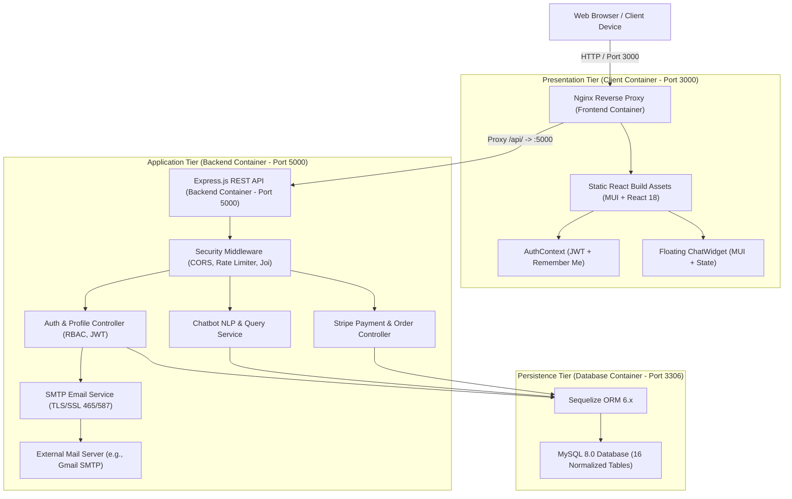

# EduMart: Comprehensive Project Summary & Architectural Report

> **Document ID**: `EDUMART-REPORT-PROJECT-SUMMARY`  
> **Project Title**: EduMart — Educational Materials E-Commerce Marketplace  
> **Version**: 2.0.0 (Production-Ready Architecture Release)  
> **Date**: October 2026  
> **Status**: **Active & Verified**  
> **Repository**: [https://github.com/SLxnoat/EduMart](https://github.com/SLxnoat/EduMart)  

---

## 📑 Executive Summary

**EduMart** is a modern, full-stack e-commerce marketplace dedicated to democratizing access to educational resources across Sri Lanka and beyond. The platform provides a centralized, secure, and intuitive ecosystem for buying, selling, and distributing study materials, including past examination papers, model question sets, structured revision notes, syllabi, e-books, and recorded lecture series.

By bridging students, independent tutors, and educational institutes, EduMart eliminates fragmented study material distribution. The platform integrates role-based account management, secure multi-channel digital and physical delivery, automated Stripe payment processing, strict SMTP-based inbox email verification, and a 24/7 AI-powered customer support chatbot.

```
+---------------------------------------------------------------------------------------------------+
|                                      EDUMART AT A GLANCE                                          |
+--------------------------+----------------------------+-----------------------+-------------------+
| 👥 Multi-Role Ecosystem  | 🛒 E-Commerce & Delivery   | 🤖 24/7 AI Assistant  | 🛡️ OWASP Hardened |
| Students, Tutors,        | Digital Downloads &        | Floating NLP Chatbot  | 12-round bcrypt,  |
| Institutes, Admins       | Physical Shipments         | with DB Order Bridges | JWT Revocation    |
+--------------------------+----------------------------+-----------------------+-------------------+
| 🐳 Dockerized Stack      | 📧 Strict SMTP Inbox Auth  | 🗄️ 16-Table Schema   | 🧪 Automated Tests|
| Client:3000 | Server:5000| Port 465 SSL / 587 TLS     | MySQL 8.0 + UUID      | Backend & Frontend|
| DB:3306 (Multi-stage)    | Zero Client Token Leaks    | Binary Optimization   | Passing Suites    |
+--------------------------+----------------------------+-----------------------+-------------------+
```

---

## 🏛️ System Architecture

EduMart is architected as a containerized, decoupled multi-tier web application adhering to modern cloud-native standards.



### Infrastructure Port Map & Services

| Service Name | Container Name | Technology | Internal Port | Host Port | Role & Functionality |
|---|---|---|:---:|:---:|---|
| **Client** | `edumart_client` | React 18, MUI, Nginx Alpine | 80 | **3000** | Serves compiled SPA and reverse-proxies `/api` requests to backend |
| **Backend** | `edumart_server` | Node.js v20/22, Express.js | 5000 | **5000** | REST API engine, authentication, business logic, NLP chatbot engine |
| **Database** | `edumart_db` | MySQL 8.0 Community | 3306 | **3306** | Relational data persistence with UUID primary keys & volume mapping |

---

## 🧩 Core Platform Modules

### 1. User Authentication, Session Security & Email Verification
- **Multi-Role Registration (`POST /api/auth/register`)**: Supports role assignment for `student`, `tutor`, and `institute`. Validates password strength (8+ chars, uppercase, digits, symbols) and sanitizes inputs against XSS.
- **Strict Inbox Email Verification (`POST /api/auth/verify-email`)**:
  - Accounts are created with `is_verified: false` and a cryptographically generated token.
  - Verification emails are dispatched to the user's specific email address via native TLS/STARTTLS SMTP (`emailService.js`).
  - No verification tokens or mock links are leaked to the client browser.
  - The account becomes verified only when the email recipient opens their inbox and clicks the verification link (`http://localhost:3000/verify-email?token=...`).
  - Provides a self-service resend mechanism (`POST /api/auth/resend-verification`) with rate-limiting.
- **Session Tracking & Instant Revocation (`POST /api/auth/logout`)**:
  - Issues RFC 7519 compliant JSON Web Tokens (24-hour expiry).
  - Every login records a session entry in the `sessions` database table.
  - Logging out immediately invalidates the token in the database, preventing replay attacks.
- **Password Recovery (`POST /api/auth/forgot-password` & `POST /api/auth/reset-password`)**:
  - Issues 1-hour time-limited cryptographic reset tokens sent directly to user inboxes.
  - Generic status messages prevent user email enumeration.

### 2. Profile Management & Role-Based Access Control (RBAC)
- **Dynamic Profile Completeness Engine**: Computes a real-time score (`0–100%`) based on verified email (+20%), phone number (+20%), institution (+20%), and role completion (+20%). Displays actionable guidance tips.
- **3-Tab Material-UI Profile Dashboard**:
  - *Personal Details*: Updates name, contact phone, and educational institution.
  - *Account Details*: Displays verified badges, member role chip, user ID, member join date, and last login timestamp.
  - *Security*: In-app self-service password update requiring current password validation.
- **End-to-End Route Protection**:
  - Backend middleware (`protect`, `authorize`, `admin`, `seller`, `institute`).
  - Frontend route guards (`<Guard roles={['admin']}>` & `PrivateRoute`) protecting sensitive views like `/admin` and `/profile`.

### 3. 24/7 AI Customer Support Chatbot
- **Interactive Floating Widget**: Built using Material-UI (`ChatWidget.js`, `MessageItem.js`, `QuickReplies.js`), accessible on every page with unread badge indicators and collapse/expand controls.
- **NLP Intent Classification Engine (`chatbotService.js`)**:
  - Instant FAQ resolution: digital download instructions, tutor onboarding, commission rates, payment issues, refund policies, and shipping.
  - Interactive quick-reply buttons allow one-click assistance.
- **Live Database Bridges**:
  - *Order Tracking Bridge*: Real-time lookup of customer orders by ID (e.g. `ORD-2026-0001`) displaying status, totals, and delivery details.
  - *Catalog Search Bridge*: Real-time lookup of educational materials by subject or keyword directly from the `Product` model.
- **History & Feedback**:
  - Persists chat conversations in `sessionStorage` and database (`ai_interactions` table).
  - Collects Thumbs Up/Down helpfulness feedback and 1–5 star service ratings.

### 4. Marketplace Catalog, Cart & Checkout
- **Hierarchical Categories**: Multi-level categorization (Grade, Subject, Exam Board, Material Type).
- **Dual Delivery Modes**:
  - *Digital Assets*: Immediate download access for e-books, model papers, and past paper answers with link expiry tracking.
  - *Physical Delivery*: Integrated tracking with courier partners for printed textbooks and revision packs.
- **Checkout & Coupon Engine**: Multi-item shopping cart supporting percentage and flat discounts with expiration and maximum usage constraints.
- **Stripe Payments**: End-to-end payment processing with raw webhook signature validation (`/api/payments/webhook`).

### 5. Administration & Marketplace Governance
- **Role-Gated Admin Portal**: System dashboard for user moderation, catalog verification, order dispute resolution, and review moderation.
- **Seller Payouts**: Automated calculation of platform commissions and net seller earnings (`seller_earnings` table).

---

## 🗄️ Database Architecture

The relational schema is implemented in MySQL 8.0 (`sql/database_schema.sql`) and mirrored via Sequelize ORM 6.x models with SQLite compatibility for in-memory unit testing.

### Relational Table Summary (16 Tables)

| # | Table Name | Primary Key | Key Relationships & Purpose |
|---|---|---|---|
| 1 | `users` | `CHAR(36) BINARY` (UUID) | Central user accounts, roles (`student`, `tutor`, `admin`, `institute`), verification tokens |
| 2 | `product_categories` | `INT AUTO_INCREMENT` | Self-referential hierarchical category tree (`parent_id`) |
| 3 | `products` | `CHAR(36) BINARY` (UUID) | Material listings linked to `users.id` (seller) and `product_categories.id` |
| 4 | `digital_assets` | `CHAR(36) BINARY` (UUID) | Digital downloadable files linked to `products.id` with download limits |
| 5 | `orders` | `CHAR(36) BINARY` (UUID) | Customer orders linked to `users.id` (buyer) with tracking numbers |
| 6 | `order_items` | `CHAR(36) BINARY` (UUID) | Line items linked to `orders.id` and `products.id` |
| 7 | `payments` | `CHAR(36) BINARY` (UUID) | Stripe transactions, payment intent IDs, amounts, and statuses |
| 8 | `reviews` | `CHAR(36) BINARY` (UUID) | Product ratings (1–5) and feedback linked to buyer and product |
| 9 | `notifications` | `CHAR(36) BINARY` (UUID) | User system alerts, verification notices, and order status updates |
| 10 | `coupons` | `INT AUTO_INCREMENT` | Promotional discount codes with validity dates and usage caps |
| 11 | `coupon_usage` | `INT AUTO_INCREMENT` | Audit log of applied coupons per user and order |
| 12 | `seller_earnings` | `CHAR(36) BINARY` (UUID) | Seller revenue share, platform commission rates, and payout statuses |
| 13 | `shipments` | `CHAR(36) BINARY` (UUID) | Physical package delivery status, carrier info, and tracking links |
| 14 | `ai_interactions` | `CHAR(36) BINARY` (UUID) | Chatbot session messages, matched intents, feedback ratings |
| 15 | `sessions` | `CHAR(36) BINARY` (UUID) | Active JWT tokens, user agents, IP addresses, revocation flags |
| 16 | `admin_actions` | `CHAR(36) BINARY` (UUID) | Audit log of administrator moderation, role adjustments, and refunds |

---

## 🔒 Security & OWASP Hardening

EduMart incorporates strict defensive engineering across all application layers:

1. **Cryptographic Password Hashing**: Utilizes `bcryptjs` with **12 salt rounds** for all user credentials.
2. **XSS & Injection Protection**: Input sanitization via `validator.escape()` across all text inputs combined with Sequelize parameterized SQL queries.
3. **Strict Schema Validation**: 8 dedicated Joi schemas (`userValidator.js`) enforcing strict boundary, format, and complexity rules.
4. **Rate Limiting**:
   - `authRateLimiter`: Enforces a maximum of 5 authentication attempts per minute per IP to prevent brute-force attacks.
   - `apiRateLimiter`: Enforces a maximum of 100 requests per minute per IP across public API endpoints.
5. **No Client-Side Token Leaks**: Verification tokens, reset tokens, and sensitive credentials are never returned in client JSON responses during production; they are strictly sent via outbound SMTP emails.
6. **Token Invalidation on Logout**: Session-tracked JWT tokens are checked against the database on protected routes. Logout revokes the session immediately.
7. **CORS Configuration**: Restricts API access strictly to the configured `FRONTEND_URL`.

---

## 👥 Team Roles & Responsibilities

The EduMart platform was developed by an integrated team of 5 software engineers:

| Team Member | Core Module Ownership | Major Deliverables |
|---|---|---|
| **Kushmi (Kaushini Ekanayake)** | **User Authentication, Profile Management, RBAC, and AI Chatbot Integration** | Multi-role registration & login, strict SMTP email verification, session revocation, dynamic profile completion engine, floating AI Chatbot widget with live Order & Product database query bridges, comprehensive test suites. |
| **Charuka** | **Payment Gateway, Order Management, Backend Infrastructure, and AI Integration** | Stripe payment integration, raw webhook verification, sandbox/live payment processing, complete Order Management API (`/api/orders`), end-to-end multi-step Checkout UI, Order History & Order Details tracking views, Docker Compose orchestration, AI integration co-lead. |
| **Vidula** | **Product Catalog, Search & Filtering System** | Multi-attribute search (subject, grade, curriculum, price), category browsing, product detail views, digital asset associations. |
| **Bhanuka** | **Shopping Cart, Multi-Item Checkout & Coupon Engine** | Persistent shopping cart state, discount coupon validation engine, order item calculation, checkout flow. |
| **Malki** | **Admin Dashboard, Review System, Notifications & Seller Dashboard** | Administrator management interface, star reviews and feedback moderation, user notification delivery, seller sales analytics and commission tracking. |

---

## 🧪 Testing & Quality Assurance

The codebase includes automated test suites covering backend API logic, security constraints, and frontend user interactions:

### Backend Test Suites (Jest + SuperTest — 41 Tests Passing)
- Runs against an in-memory SQLite database (`jest.setup.js`) ensuring zero side-effects.
- **Coverage**:
  - User registration & XSS sanitization
  - Duplicate email detection & missing field validation
  - Login authentication & session creation
  - Session revocation upon logout (`POST /api/auth/logout`)
  - IP rate limiting enforcement (429 Too Many Requests)
  - Tokenized email verification & resend verification flow
  - Forgot password & reset password lifecycle
  - Profile retrieval, updates, and password change self-service
  - Role-based access control (`GET /api/users/:id` permission boundary)
  - Chatbot FAQ intent matching, catalog search, order tracking, and feedback collection
  - **Payment Processing**: Stripe PaymentIntent creation, signature webhook handling with `user_id` resolution, sandbox payment simulation, and payment status verification
  - **Order Management**: Order and OrderItem creation with financial calculations (subtotal, tax, shipping, discount), customer order history retrieval, single order detail view, admin/seller status updates, and order cancellation
- **Command**:
  ```bash
  cd server
  npm test
  ```

### Frontend Test Suites (React Testing Library + Jest — 9 Tests Passing)
- **Coverage**:
  - Base application and layout rendering
  - Authentication loading state handling
  - Role-based `<Guard roles={['admin']}>` access prevention and redirection
  - Profile unverified email warning banner and next-step completion tips
  - ChatWidget floating button toggle, quick-reply triggers, and messaging display
  - **Checkout Flow**: Shipping & delivery address input, order summary calculations, payment method selection, card form processing, and order confirmation
  - **Order History**: User order table rendering, status chips, and detail navigation
  - **Order Detail**: Line item breakdown, digital PDF download access trigger, delivery address summary, and cancellation modal
- **Command**:
  ```bash
  cd client
  npm test -- --watchAll=false
  ```

---

## 🚀 Deployment & Getting Started Quick Reference

### 1. Run Containerized Stack (Recommended)
```bash
# 1. Clone repository
git clone https://github.com/SLxnoat/EduMart
cd EduMart

# 2. Configure environment
cp .env.example .env

# 3. Launch stack
docker compose up --build -d
```
- **Frontend App**: [http://localhost:3000](http://localhost:3000)
- **Backend API**: [http://localhost:5000/api](http://localhost:5000/api)
- **Health Check**: [http://localhost:5000/health](http://localhost:5000/health)

### 2. Configure Real SMTP Email Verification
Edit `.env` in the project root:
```env
SMTP_HOST=smtp.gmail.com
SMTP_PORT=465
SMTP_USER=your_email@gmail.com
SMTP_PASS=your_16_character_app_password
SMTP_FROM=your_email@gmail.com
FRONTEND_URL=http://localhost:3000
```
Then restart containers: `docker compose up -d`.

---

## 📑 Complete Documentation Directory Reference

All foundational project documentation is maintained in the [`docs/`](../docs) directory:

1. **[project_summary.md](project_summary.md)** *(This Document)* — Complete, unified platform summary and architecture report.
2. **[technical_architecture.md](technical_architecture.md)** — In-depth architectural specifications, Mermaid sequence and data-flow diagrams.
3. **[requirements.md](requirements.md)** — Functional and non-functional engineering requirements.
4. **[API_ENDPOINTS.md](API_ENDPOINTS.md)** — RESTful API specifications with request/response schemas.
5. **[sql_schema.md](sql_schema.md)** — Database entity-relationship documentation and Sequelize configurations.
6. **[sql_implementation_guide.md](sql_implementation_guide.md)** — Database setup, seeding, and execution procedures.
7. **[project_plan.md](project_plan.md)** — 8-week Agile sprint roadmap, milestones, and deliverables.
8. **[project_charter.md](project_charter.md)** — Project vision, business case, scope, and stakeholder alignment.
9. **[team_roles.md](team_roles.md)** — Detailed member responsibility and module assignment matrix.
10. **[wireframes.md](wireframes.md)** — UI wireframes, color schemes, and responsive layout standards.

---

*Report Compiled & Verified: October 2026*  
*EduMart Engineering Team*
